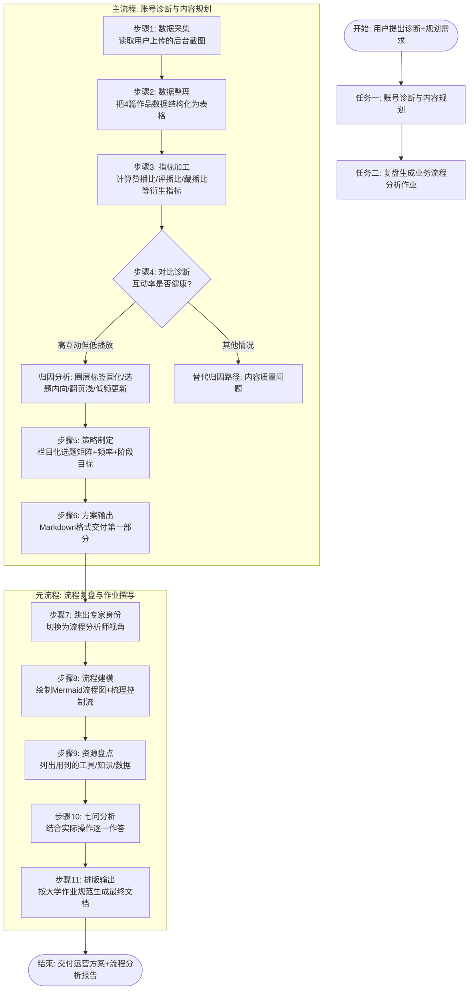

# 《业务流程分析》课程作业

**作业主题：以一次"短视频账号诊断与内容规划"业务为案例的业务流程分析**

> 案例背景：本人运营一个以「逃离玫瑰岛」同人二创为主的图文内容账号。近一个月播放量徘徊在 1700–2600 之间，出现增长停滞。本次作业以"AI 运营操盘手接受委托 → 诊断账号 → 输出两个月内容方案"的全过程为样本，完成业务流程的识别、建模与分析。

---

# 第一部分 账号诊断与两个月内容运营方案

## 1.1 数据读取与指标加工

从后台「投稿列表」截图中提取近 4 篇作品（2026-10-11 至 2026-10-31）的原始数据，并计算衍生指标：

| 发布日期 | 选题类型 | 张数 | 播放 | 点赞 | 评论 | 收藏 | 文案展开率 | 平均浏览图片 | 赞播比 | 评播比 | 藏播比 | 流量激励 |
|---|---|---|---|---|---|---|---|---|---|---|---|---|
| 10-31 | 万圣节同人特辑 | 4 | 1767 | 419 | 20 | 22 | 4.04% | 2.1 | **23.7%** | 1.13% | 1.25% | 355 |
| 10-25 | 角色生日应援 | 3 | 1802 | 351 | **3** | 18 | **0.95%** | 2.0 | 19.5% | 0.17% | 1.00% | 295 |
| 10-17 | 美工存档 | 12 | 2583 | 311 | 24 | 20 | 3.15% | 2.9 | 12.0% | 0.93% | 0.77% | **776** |
| 10-11 | 同人二创·谜语 | 3 | 1895 | 365 | 10 | 24 | 4.04% | **1.8** | 19.3% | 0.53% | 1.27% | 559 |

## 1.2 核心诊断：问题不在"内容质量"，而在"流量入口"

**结论先行：这是一个典型的"高粘性小圈层账号"瓶颈——互动率极其优秀（赞播比 12%–24%，远高于 3%–5% 的行业健康线），但播放量天花板被锁死在 2500 左右。原因是流量入口收窄，而非内容变差。**

四条关键证据：

1. **选题过于"内向"，破圈能力弱。** 生日应援、美工存档属于"给已有粉丝看的选题"，无泛流量钩子。生日帖文案展开率仅 0.95%（其余 3 篇均 3% 以上）、评论只有 3 条，说明陌生用户看到标题直接划走，平台自然不给加推。
2. **图组翻页深度不足，完读率拖后腿。** 平均浏览图片仅 1.8–2.9 张/组，意味着 3 张图的作品近一半用户没看第 2 张。图组前两页没有"翻页钩子"，算法判定内容消费深度不足，不敢推更大流量池。
3. **账号标签高度固化。** 发布内容 100% 依赖「逃离玫瑰岛 / 弥笑白 / 虞青 / 奇洛李维斯回信」等单一圈层标签，流量池被算法锁进同人圈，圈层总盘子有限，播放自然封顶。
4. **发布节奏低频且不规律。** 一个月仅 4 更（间隔 6–8 天），且发布时间不固定，账号活跃度权重难以积累，也无法形成粉丝追更习惯。

**总体判断：账号基本面是好的（粉丝极爱、互动健康），当前是"流量结构"问题——需要在不丢老粉的前提下，用栏目化选题 + 翻页钩子 + 稳定节奏，把流量池从"圈层内"扩到"泛兴趣层"。**

## 1.3 未来两个月发布内容安排

### A. 内容定位

以「逃离玫瑰岛同人创作」为根据地，用**三档固定栏目**拓展受众：

| 栏目 | 定位 | 作用 |
|---|---|---|
| 【谜语/互动】系列 | 猜谜、找细节、剧情互动 | 拉评论、拉翻页，10-11 那篇已验证（展开率 4.04%） |
| 【创作过程】系列 | 美工存档升级为"存档+过程+翻车故事" | 拉收藏、破圈到"手作/绘画"兴趣层 |
| 【节点热点】系列 | 万圣节、圣诞、跨年等节点同人特辑 | 借节日泛流量给账号打新标签 |

### B. 发布频率与时间

- **每周 2–3 更**（固定周二、周五、周日）；
- 发布时间固定在 **19:00–21:00**（数据显示既有作品均在此档发布且获得激励，且晚间为图文消费高峰）；
- 连续 8 周不断更，把"稳定更新"本身变成账号权重。

### C. 八周排期与阶段目标

| 阶段 | 时间 | 内容安排 | 阶段目标 |
|---|---|---|---|
| 第 1 阶段：修复基础盘 | 第 1–2 周 | ① 【谜语】系列第 2 期（延续已验证格式）；② 【创作过程】存档篇：12 张图改为"前 2 张放成品对比图做钩子"；③ 保留粉丝向生日/应援内容，但标题必须加泛化钩子（如"画了 TA 的生日，评论区留下祝福"） | 播放中位数 1900 → **3000**；平均浏览图片 2.2 → **3.0** |
| 第 2 阶段：测试破圈 | 第 3–5 周 | ① 圣诞节点同人特辑 ×1；② 【创作过程】×2，尝试"求助式"标题（"这个配色帮我看看还差什么"）；③ 【谜语】×2；④ 每周复盘一次数据，淘汰展开率 <2% 的标题写法 | 出现 1 条播放 **破 5000** 的作品；新客评论占比提升到 30% |
| 第 3 阶段：放大复制 | 第 6–8 周 | 对第 2 阶段数据最好的一条选题做**系列化**（拆成上中下 3 期连更）；跨年节点特辑 ×1；穿插 1 期粉丝互动（评论区选题） | 单条播放 **破 10000**；月均播放中位数稳定 4000+；收藏率保持 1% 以上 |

### D. 每条作品的执行清单（落地细节）

1. **封面即钩子**：第 1 张图必须是成品/悬念画面，禁止直接放存档截图；
2. **翻页钩子**：第 2 张图埋"下一张有彩蛋/反转"提示，把平均浏览图片拉到 3 以上；
3. **标题双段式**：圈层梗（保老粉）+ 泛化问题或悬念（拉新客），例：「【谜语】岛城猫咖开业🐾 第 3 个细节只有真爱粉能找到」；
4. **标签结构**：3 个圈层标签 + 3 个泛兴趣标签（如 #手绘过程 #同人图 #图文创作）；
5. **发布后 1 小时**：置顶评论抛问题引导互动（评论是激励的强权重信号）；
6. **每周复盘**：跟踪 4 个指标——播放中位数、文案展开率、平均浏览图片、评播比。

---

# 第二部分 业务流程复盘（系统/流程分析师视角）

## 2.1 本次业务的总体流程图

## 2.2 调用的工具/技能清单

| 序号 | 工具/技能 | 在流程中的用途 | 对应环节 |
|---|---|---|---|
| 1 | **图像识别与数据提取** | 读取用户上传的后台截图，把图片中的非结构化数据（播放、点赞、展开率等）转为结构化数据 | 步骤 1 |
| 2 | **数据整理与指标体系构建** | 设计"赞播比/评播比/藏播比/展开率"等衍生指标，形成对比分析用的指标表 | 步骤 2–3 |
| 3 | **对比分析模型（基准对比法）** | 将本账号互动率与行业健康基准（赞播比 3%–5%）对比，定位"高互动低播放"矛盾点 | 步骤 4 |
| 4 | **平台推荐算法知识库**（图文流量池机制：互动权重、翻页深度、标签体系、发布稳定性） | 解释"为什么互动好却没播放"，支撑归因分析 | 步骤 4–5 |
| 5 | **归因诊断框架**（假设—验证法） | 提出 4 个假设（选题内向/翻页浅/标签固化/低频），逐条用截图数据验证 | 步骤 4 |
| 6 | **内容策划方法论**（选题矩阵、栏目化运营、钩子设计） | 产出三档栏目与八周排期 | 步骤 5–6 |
| 7 | **SMART 目标设定法** | 把方案目标写成可量化、分阶段的指标（播放中位数 3000/5000/10000） | 步骤 5–6 |
| 8 | **流程建模工具（Mermaid 流程图）** | 复盘阶段把工作过程抽象为带控制流的图形化模型 | 步骤 8 |
| 9 | **结构化写作与文档排版规范** | 按大学作业要求分层输出 Markdown 文档 | 步骤 11 |

## 2.3 流程中的控制流与流程间关系

- **判断（分支）**：步骤 4 "互动率是否健康？"是典型的决策节点——数据表明互动率高，于是走"流量结构归因"分支而非"内容质量归因"分支；
- **会合**：四条归因结论（选题、翻页、标签、频率）在步骤 5 处会合，共同输入策略制定；
- **同步关系**：主流程（诊断规划）与元流程（复盘分析）是**先后串行**关系——元流程以主流程的完整输出为输入；
- **多流程关系**：①数据采集流程是诊断流程的**前置流程**；②诊断流程是规划流程的**触发流程**；③复盘流程是以上三个流程的**监控/元流程**（对流程本身做分析）。

---

# 第三部分 《业务流程分析》七问

> 以下回答全部基于本次"账号诊断与内容规划"任务的真实执行过程。

## 问题 1：有哪些业务流程？各自的目的或目标是什么？

本次任务包含 **4 个业务流程**：

| 流程 | 目的/目标 |
|---|---|
| ① 数据采集流程 | 从后台截图中获取 4 篇作品的原始运营数据，为诊断提供事实依据 |
| ② 数据诊断流程 | 回答"为什么最近播放量出问题"——定位增长停滞的真实原因 |
| ③ 内容规划流程 | 把诊断结论转化为可执行的未来两个月发布方案（选题、频率、阶段目标） |
| ④ 流程复盘流程（元流程） | 把前三个流程作为分析对象，输出符合大学作业要求的业务流程分析报告 |

## 问题 2：流程如何完成？有哪些任务、步骤和活动的起止条件？

以**数据诊断流程**为例，其任务链为：

1. **数据整理**（输入：截图 → 输出：结构化数据表）；
2. **指标加工**（计算赞播比 23.7%、展开率对比等衍生指标）；
3. **基准对比**（与本行业健康基准线对比）；
4. **假设验证**（依次验证"选题内向、翻页浅、标签固化、更新低频"四个假设）；
5. **归因输出**（形成"流量入口收窄"的最终结论）。

**活动执行的起止条件：**
- **开始条件**：上游流程产出物就绪且格式可读（如诊断流程的启动条件是"原始数据已结构化"；内容规划流程的启动条件是"诊断结论已形成"）；
- **结束条件**：产出物达到下游可使用的质量标准即结束——数据采集流程在"4 篇作品的 8 个字段全部提取完毕"时结束；诊断流程在"能同时解释全部 4 篇作品的表现差异"时结束（仅解释单篇不算完成，例如"选题内向"能解释生日帖的 0.95% 展开率，也能反向解释互动帖的 4.04%，通过了验证）。

## 问题 3：流程有谁参与？各自完成哪些活动？

| 参与方 | 角色 | 完成的活动 |
|---|---|---|
| 用户（我） | 需求方/数据提供者 | 提出诊断与规划需求；提供后台截图（唯一的数据源）；提供作业要求作为验收标准 |
| AI 操盘手 | 分析执行者 | 数据提取、指标计算、对比诊断、归因分析、策略制定、方案撰写 |
| （隐含参与）平台算法规则 | 客观约束/规则供给方 | 其图文推荐机制（互动权重、流量池分层、标签体系）是诊断与策略的依据 |

## 问题 4：流程中有哪些控制流？多个流程之间是什么关系？

**控制流实例（全部真实发生在本次过程中）：**

- **判断分支**：诊断流程中的关键决策——"互动率是否高于健康基准？"。结果为"是"，流程走向"流量结构归因"分支；若为"否"，将走向"内容质量归因"分支（重新评估选题与制作水平）。
- **会合（And-Join）**：四条归因结论（选题内向、翻页浅、标签固化、低频更新）必须**全部完成验证**后，才汇合进入策略制定环节——任何一条未验证就出方案都是不严谨的。
- **同步/串行依赖**：规划流程必须等待诊断流程结束（内容规划依赖"谜语类内容已验证有效"这一结论才被排进八周计划）。
- **循环（迭代）**：方案中的"每周复盘 → 淘汰低展开率标题 → 优化下一条"本身设计了**持续循环**的控制流。

**流程间关系：** 数据采集是诊断的**前置流程**；诊断是规划的**触发与输入流程**；三者共同构成"主流程链"，而复盘流程是覆盖主流程链的**元流程**（监控级流程），它与主流程是"被分析与分析"的关系，且必须**串行**于主流程结束之后。

## 问题 5：流程用了哪些方式或手段来完成？

| 方式/手段 | 具体应用 |
|---|---|
| 结构化处理 | 把截图信息转为数据表，把定性感受转为可量化指标（赞播比、藏播比） |
| 基准对比分析 | 用行业基准（赞播比 3%–5%）与本账号 12%–24% 对比，一秒锁定"互动强、流量弱"的矛盾结构 |
| 假设—验证推理 | 对 4 个候选原因逐一用截图中的数据交叉验证（如用生日帖展开率 0.95% vs 谜语帖 4.04% 验证"选题钩子"假设） |
| 方法论套用 | 流量池机制知识用于归因；选题矩阵/栏目化运营/SMART 目标用于规划 |
| 模型化表达 | 用 Mermaid 流程图把隐性工作过程显性化 |
| 模板化输出 | 按作业排版规范用 Markdown 分层输出 |

## 问题 6：所用资源及成本如何？各环节的增值作用如何？

**资源盘点与成本：**

| 资源类型 | 具体内容 | 成本 |
|---|---|---|
| 物理资源 | 后台截图 1 张（用户侧）、计算与存储环境（AI 侧） | 近乎为零 |
| 人力成本 | 用户约 5 分钟（截图上传+提出需求）；AI 撰写约 1 次会话 | 极低 |
| 知识资源 | 平台算法机制知识库、内容运营方法论、指标体系设计经验、流程建模知识 | 已内置于 AI，边际成本为零 |

**各环节增值作用：**

| 环节 | 输入 | 输出 | 增值点 |
|---|---|---|---|
| 数据采集 | 截图（人类不可直接分析的图像） | 结构化数据表 | **信息形态增值**：从"看得见"变为"算得了" |
| 指标加工 | 原始字段 | 衍生指标 | **信息密度增值**：赞播比 23.7% 单看无意义，对比后才有诊断力 |
| 诊断分析 | 指标表 | 问题归因 | **信息→洞察增值**：从"数据是什么"回答了"数据为什么" |
| 内容规划 | 归因结论 | 八周可执行排期 | **洞察→行动增值**：把结论翻译成带时间、带指标、带清单的行动 |
| 流程复盘 | 整个主过程 | 分析报告 | **经验资产增值**：把一次性工作沉淀为可复用的流程知识 |

整体上，本流程是典型的**知识型服务流程**：无实物搬运，每一步都在提升信息的"可决策性"。

## 问题 7：流程中是否存在瓶颈或阻塞排队现象？

**存在，共三处：**

1. **最大的瓶颈：数据输入端的阻塞。** 本次数据采集只能基于 1 张截图、4 篇作品的 8 个字段。缺粉丝画像、流量来源构成、历史播放曲线、前作数据，导致诊断只能做"横截面对比"，无法做"时间序列归因"——**分析精度被上游输入卡壳**。这相当于制造企业的"来料检验环节等料"：AI 计算能力再强，也得等料。*解法（已在方案中落地）：把"每周固定复盘 4 项指标"写进运营节奏，变一次喂料为持续供料。*
2. **串行依赖造成的等待。** 严格串行链"采集 → 诊断 → 规划"意味着规划环节在诊断完成前完全空闲。本次因每步耗时极短，等待可忽略；但在更大规模流程（如多账号批量诊断）中，可把"规划框架搭建"与"诊断验证"**并行**以压缩总时长。
3. **一次性判断点的风险堆积。** 诊断流程只有一个关键决策分支（互动率是否健康），且验证依赖有限样本。若该判断点出错，错误会**排队传递**到规划环节并逐级放大。*解法：方案中设计了第 2–5 周的数据验证回路，用真实投放结果对诊断假设做二次校验，形成纠错循环。*

**结论：本流程的主要瓶颈不在处理端而在输入端（数据完整度），且属于"结构性瓶颈"——需要通过改变数据供给方式（建立每周复盘机制）而非提高处理能力来解决，这正符合流程管理中"先消除等待、再优化节拍"的原则。**

---

*作业完。所有诊断结论与七问回答均严格基于本次任务的真实执行过程，涉及的数据来自用户提供的账号后台截图（2026-10-11 至 2026-10-31，共 4 篇作品）。*
