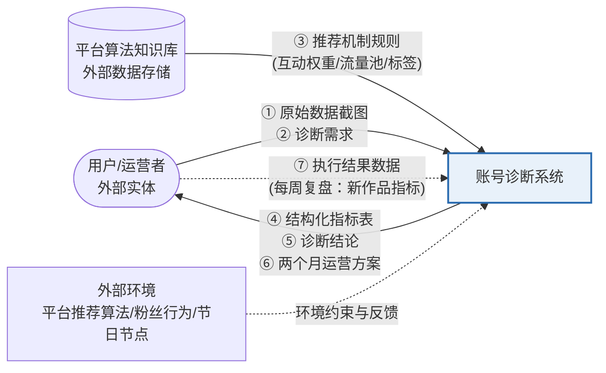
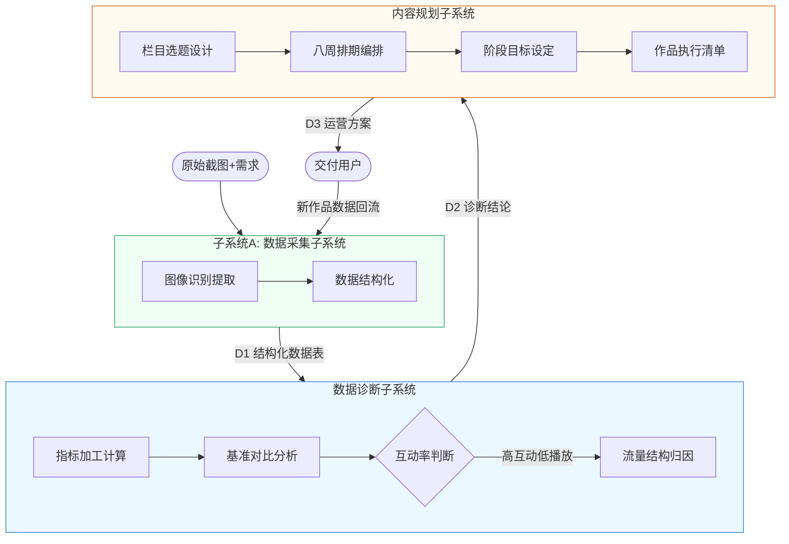
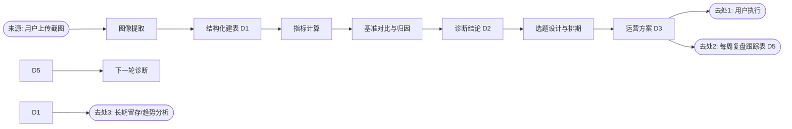

# 《数据流分析》课程作业

**作业主题：以"AI 账号诊断系统"为案例的数据流分析**

> 案例延续：本作业把上一次"账号诊断与内容规划"业务中承担分析工作的系统抽象为一个**信息处理系统**（以下简称"诊断系统"），从数据流视角回答七个启发问题。系统中流动的每一项数据，均来自该次任务的真实执行过程。

---

## 问题 1：系统作为信息处理器主要完成什么功能？最重要的输入和输出数据是什么？

### 1.1 系统的主要功能

诊断系统的核心功能可以概括为一句话：**把"原始运营数据"加工为"可执行的运营决策"**。它不是简单的数据搬运，而是一条"数据 → 信息 → 洞察 → 决策"的加工链。

### 1.2 最重要的输入数据

| 输入数据 | 来源 | 形态 | 作用 |
|---|---|---|---|
| **账号后台投稿截图**（唯一事实数据源） | 用户上传 | 非结构化图像 | 含 4 篇作品 × 8 个字段（发布时间、张数、播放、点赞、评论、收藏、文案展开率、平均浏览图片）及流量激励金额 |
| **诊断需求描述** | 用户口头输入 | 自然语言文本 | "分析播放量为什么出问题 + 制定两个月内容安排"，决定了系统的加工方向 |
| **平台算法知识库**（预置） | 系统内置 | 结构化知识 | 图文流量池机制、互动权重、标签体系、发布节奏规律，是归因分析的解释框架 |

### 1.3 最重要的输出数据

| 输出数据 | 形态 | 作用 |
|---|---|---|
| **结构化数据指标表** | 表格 | 4 篇作品原始数据 + 派生指标（赞播比、评播比、藏播比） |
| **诊断结论** | 自然语言 + 证据链 | "高互动低播放 → 流量入口收窄"，附 4 条归因证据 |
| **两个月内容运营方案** | 结构化文档 | 栏目矩阵、八周排期、阶段目标（播放中位数 3000 → 破 5000 → 破 10000）、作品执行清单 |

其中**最关键的一对输入/输出**是：输入"4 篇作品的表现数据"，输出"诊断归因结论"——这一步完成了从"数据是什么"到"数据为什么"的质变，是整个系统增值最大的环节。

## 问题 2：系统作为一个整体，和外界环境存在什么关系？

系统与外部环境的交互关系（顶层关联图 / 0 层数据流图）：



系统与环境的四层关系：

1. **输入关系（依赖）**：系统的全部事实依据来自环境——数据靠用户提供，规则靠平台算法环境决定，系统自身不产生原始事实；
2. **输出关系（服务）**：系统向环境（用户）交付决策方案，方案质量最终由真实投放效果检验；
3. **反馈关系（闭环）**：方案被执行后产生的新作品数据（新播放量、展开率）作为反馈数据重新流入系统，构成"诊断 → 方案 → 执行 → 复盘"的**开放反馈环**；
4. **约束关系（被动适应）**：平台算法规则（如图文流量池分层、互动加权）是系统不可控的环境变量，系统只能解读并适应它，这解释了为什么诊断结论必须随环境（算法改版）动态更新。

## 问题 3：系统功能复杂，能否分解为几个相对独立又有联系的子系统或子功能？

可以。按数据加工链分解为 **4 个子系统**（1 层数据流图）：



| 子系统 | 职责边界 | 相对独立性 | 与其他子系统的联系 |
|---|---|---|---|
| A 数据采集子系统 | 图像→结构化数据 | 不需要任何运营知识，只依赖图像识别能力 | 唯一的对外数据入口 |
| B 数据诊断子系统 | 数据→归因结论 | 不负责产出方案，只回答"为什么" | 通过数据存储 D1 与 A 解耦 |
| C 内容规划子系统 | 结论→可执行方案 | 不做数据分析，只做策略翻译 | 以 D2（诊断结论）为唯一输入 |
| D 复盘回流子系统（隐含） | 执行数据→再诊断 | 周期性运行而非每次运行 | 把输出重新接回输入，形成闭环 |

**解耦的关键设计**：各子系统之间不直接调用，而是通过**数据存储**（D1 数据表、D2 诊断结论）传递信息——A 不关心 B 怎么分析，B 不关心 C 怎么规划，这正是数据流分析中"以数据流为接口"降低耦合度的思想。

## 问题 4：分解后的子功能是否仍然复杂，还可以划分为更细更具体的子功能吗？

可以继续向下分解（2 层数据流图）。以最复杂的 **B 数据诊断子系统**为例：

```mermaid
flowchart TD
    B1[1.指标加工] --> B1a[1.1 派生比率计算<br/>赞播比/评播比/藏播比]
    B1 --> B1b[1.2 指标汇总建表]
    B1b --> B2[2.基准对比]
    B2 --> B2a[2.1 引入行业健康基准<br/>赞播比3%-5%]
    B2 --> B2b[2.2 逐条作品横向对比<br/>4篇×6指标矩阵]
    B2b --> B3{3.矛盾点判断<br/>互动率是否健康?}
    B3 -->|是| B4[4.归因验证]
    B3 -->|否| B4x[4x.内容质量归因<br/>(备选分支)]
    B4 --> B4a[4.1 假设生成<br/>选题内向/翻页浅/标签固化/低频更新]
    B4 --> B4b[4.2 逐条数据验证<br/>如: 生日帖展开率0.95% vs 谜语帖4.04%]
    B4a --> B5[5.结论合成]
    B4b --> B5
    B5 --> OUT2(["输出诊断结论D2"])
```

**分解后的原子子功能示例：**

| 父功能 | 原子子功能 | 输入 | 输出 |
|---|---|---|---|
| 指标加工 | 派生比率计算 | 点赞 419 / 播放 1767 | 赞播比 23.7% |
| 基准对比 | 引入行业基准 | 知识库规则"健康赞播比 3%–5%" | 对比标尺 |
| 归因验证 | 假设验证（钩子假设） | 生日帖展开率 0.95%、谜语帖 4.04% | "标题钩子决定展开率"成立 |
| 结论合成 | 矛盾点整合 | 4 条已验证归因 | "流量入口收窄"总结论 |

**分解停止的条件**：当某个子功能的输入输出可以用**一条明确规则或一次直接计算**描述时（如"赞播比 = 点赞 ÷ 播放"），即停止分解——避免过度分解导致流程碎片化。

## 问题 5：每个功能或子功能的输入数据和输出数据是什么？

完整的数据流对照表：

| 功能/子功能 | 输入数据 | 输出数据 |
|---|---|---|
| 图像识别提取 | 投稿截图（图像） | 4 篇作品 × 8 字段原始数据 |
| 数据结构化 | 原始字段 | 结构化数据表（D1） |
| 派生比率计算 | 播放、点赞、评论、收藏 | 赞播比 12%–24%、评播比 0.17%–1.13%、藏播比 0.77%–1.27% |
| 基准对比 | 衍生指标 + 行业基准知识 | 矛盾点识别结果（高互动、低播放） |
| 假设验证 | 展开率、平均浏览图片、发布间隔（6–8 天） | 4 条已验证归因（选题内向/翻页浅/标签固化/低频） |
| 结论合成 | 已验证归因 | 诊断结论 D2："流量入口收窄，基本面健康" |
| 栏目选题设计 | 诊断结论 + 已验证有效格式（谜语帖展开率 4.04%） | 三档栏目定义 |
| 排期与目标设定 | 栏目 + SMART 方法 | 八周排期表 + 三阶段量化目标 |
| 执行清单编制 | 排期 + 翻页深度短板 | 6 条作品执行规则（封面钩子/翻页钩子/双段式标题等） |
| 复盘回流（设计） | 执行后新作品数据 | 下一次诊断的输入 |

## 问题 6：系统中需要长期保存的数据有哪些？这些数据如何创建、修改和使用？

| 数据存储 | 内容 | 创建方式 | 修改方式 | 使用方式 |
|---|---|---|---|---|
| **D1 结构化数据表** | 4 篇作品原始数据与派生指标 | 系统首次读取截图后一次性创建 | 每周复盘新增作品行**追加**（只增不改历史行，保证可追溯） | 诊断、对比、趋势分析的数据底座 |
| **D2 诊断结论档案** | 本次归因结论与证据链 | 诊断子系统合成输出 | 当新数据推翻旧假设时**修订**（如原假设"选题内向"被节后新数据推翻则降权） | 规划子系统的直接输入；也作为"诊断经验"供下次同类分析复用 |
| **D3 运营方案文档** | 八周排期、阶段目标、执行清单 | 规划子系统生成 | 按周复盘结果**滚动更新**（淘汰展开率 <2% 的标题写法） | 用户执行的操作手册；执行偏差回写复盘 |
| **D4 平台算法知识库** | 流量池、互动权重、标签规则 | 预置内置 | 随平台规则变化**整体升级**（外部维护） | 归因分析的解释框架 |
| **D5 复盘跟踪表** | 每周 4 项监测指标（播放中位数、展开率、浏览图片数、评播比） | 第 1 周复盘时创建 | 每周追加一行，形成时间序列 | 验证诊断假设、判断阶段目标达成度 |

**长期保存的设计原则**：
- **事实数据（D1、D5）只追加、不修改**——历史数据是趋势归因的依据，改历史等于销毁证据；
- **结论数据（D2、D3）可修订、带版本**——它们是"当前最优判断"，必须允许被新证据推翻；
- **知识数据（D4）与事实分离**——平台规则变了只升级 D4，D1/D5 不受影响。

## 问题 7：在一个业务流程中，数据从来源到最后去处是否完整？

**完整。** 追踪本次业务中每一条数据的全程流转：



**逐条数据来源—去向核对表：**

| 数据项 | 来源 | 最终去处 | 是否有消费方 |
|---|---|---|---|
| 4 篇作品原始数据 | 截图 | D1 存档 + 衍生计算 | ✅ |
| 派生指标（赞播比等） | 计算生成 | 对比分析（消费后进入诊断结论） | ✅ |
| 诊断结论 | 归因合成 | 方案生成 + D2 存档复用 | ✅ |
| 三档栏目与八周排期 | 方案生成 | 用户执行 + 每周复盘比对 | ✅ |
| 阶段目标数值 | SMART 设定 | D5 跟踪表的达成度基准线 | ✅ |
| 执行清单规则 | 方案生成 | 用户逐条执行 | ✅ |

核对结论：**流程中不存在"孤兽数据"（有来源无去处）和"无源数据"（有去处无来源）**。每一项输入数据都至少流经一个加工环节并产生可交付或可存档的输出；每一项输出数据都能沿数据流回溯到明确的来源。

**唯一的不完整风险（与上一份作业的瓶颈结论一致）**：反馈链路 D5 → 下一轮诊断是**方案中设计、尚未实际发生**的环节——新作品执行数据还没产生。因此当前时点"来源→去处"的完整性仅覆盖首轮闭环；完整闭环要到第 1 次周复盘（新数据回流）后才真正闭合。这也是数据流分析的价值所在：**在流程设计阶段就预先检查数据链路，把"数据断点"消灭在执行之前。**

---

*作业完。本分析的对象数据、加工过程与结论均来自上一任务"账号诊断与内容规划"的真实执行记录，与《业务流程分析》作业构成同一案例的"流程视角"与"数据视角"两个互补剖面。*
