# 1030实验 提交文档

# 任务一：问卷星小程序修改用户名/密码操作的事件流

> 说明：本次以"问卷星"微信小程序为具体研究对象，描述用户在其中修改账户信息（昵称/用户名、登录密码）的操作事件流。

## 一、用例概述

- **用例名称**：修改个人信息（用户名 / 密码）
- **参与者**：问卷星用户（主要参与者），问卷星小程序后台服务系统（次要参与者）
- **目标**：用户通过问卷星微信小程序修改个人账户信息（昵称/用户名、登录密码）
- **范围**：问卷星微信小程序"我的"模块 → 账号与安全设置
- **前置条件**：
  - 用户已下载并打开问卷星微信小程序；
  - 用户已通过微信授权登录或问卷星账号登录；
  - 用户处于"我的"页面，可进入"设置 / 账号与安全"页
- **后置事件**：
  - 用户昵称或登录密码在问卷星账户中被更新；
  - 系统生成一条账户信息变更日志。

## 二、主事件流

主事件流是指能够满足目标的典型的成功路径（不含条件及分支）：

1. 用户在问卷星小程序底部导航点击"我的"，进入个人中心；
2. 用户点击"设置"，进入设置页面，选择"账号与安全"（或"个人资料"）；
3. 系统显示当前账户信息（昵称 / 手机号 / 密码状态），并提供"修改昵称""修改密码"入口；
4. 用户选择修改项并输入新内容；
5. 用户提交，系统校验输入内容的格式与合法性；
6. 问卷星后台服务系统将新内容写入用户账户库；
7. 系统提示"修改成功"，返回个人中心并显示更新后的信息；
8. 系统将本次变更记录写入日志。

## 三、备选事件流

备选事件流是除主事件流之外的各种可能失败情况、替代路径或扩展路径，序列号与主事件流相对应：

- **1a**：用户微信登录态过期或未授权登录
  1. 系统弹出微信授权登录页，要求用户重新授权
  2. 用户完成授权后返回步骤 1，用例结束
- **3a**：用户选择"修改密码"，但账号为微信一键登录创建、尚未设置过密码
  1. 系统提示"当前账号未设置密码，请先设置密码"
  2. 转入"设置密码"流程（需绑定手机号并短信验证）
- **5a**：昵称输入为空或含违规字符、长度超出限制（问卷星昵称限制一般为 2~20 字符）
  1. 系统提示"昵称格式不正确，请重新输入"
  2. 返回步骤 4
- **5b**：新密码不满足强度要求（如少于 8 位、仅含数字）
  1. 系统提示"密码强度不足"
  2. 返回步骤 4
- **5c**：修改密码时输入的原密码错误
  1. 系统提示"原密码错误，还可重试 N 次"
  2. 返回步骤 4；连续错误超过 5 次则锁定操作 30 分钟，用例结束
- **5d**：修改绑定手机号/密码时，短信验证码错误或已过期
  1. 系统提示"验证码错误或已失效，请重新获取"
  2. 返回步骤 4（60 秒内不可重复获取）
- **6a**：网络异常或问卷星后台服务不可用
  1. 系统提示"修改失败，请检查网络后重试"
  2. 保留用户已输入内容，返回步骤 5
- **6b**：新昵称与其他用户昵称重复（如系统开启昵称唯一性校验）
  1. 系统提示"该昵称已被占用"
  2. 返回步骤 4

## 四、发生频率

**低频操作**：普通用户通常在首次使用或需要时修改，单用户年均为 1~3 次；按问卷星日活跃用户百万级估算，平台整体日均发生量约数千至万次级。

## 五、补充说明（问卷星特点）

| 项目 | 说明 |
|---|---|
| 登录方式 | 支持微信一键登录、手机号+验证码、账号+密码，不同方式可修改的项目不同（微信登录用户昵称与微信昵称同步） |
| 修改入口 | 我的 → 设置 → 账号与安全；部分版本在"个人资料"页 |
| 是否需验证 | 修改密码需验证原密码；修改手机号需短信验证码 |
| 影响范围 | 昵称修改会影响问卷页展示的创建者署名；密码修改不影响已发布问卷 |

---

# 任务二：图书馆管理系统 UML 图

> 以下各图均为 PlantUML 源码，可直接粘贴到 PlantUML / VS Code 插件 / 在线渲染器（plantuml.com）中生成图片。

## 2.1 Use case diagram（用例图）

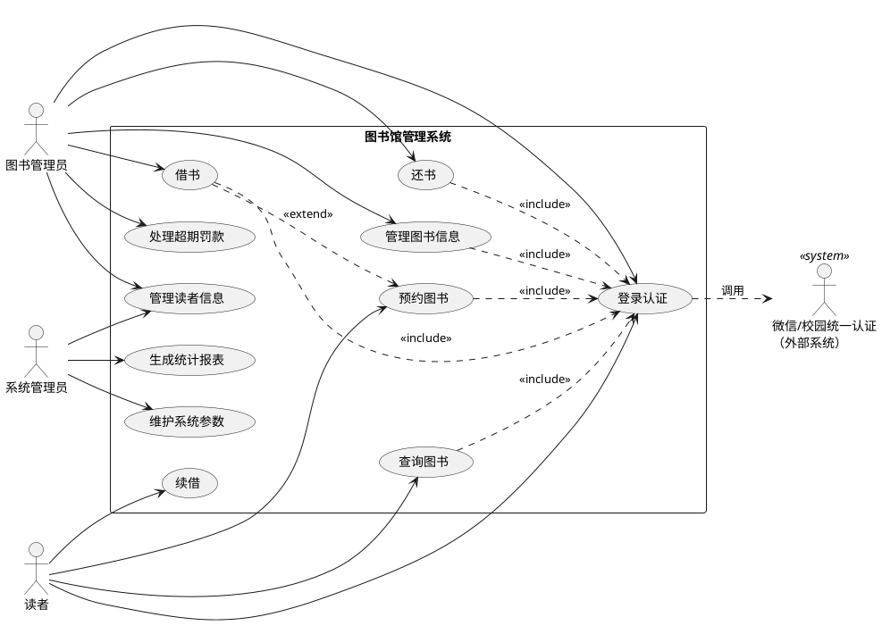

## 2.2 Class diagram（类图）

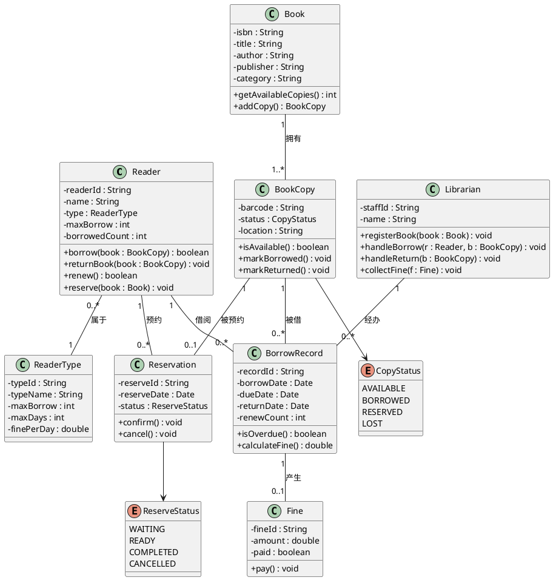

## 2.3 Object diagram（对象图）

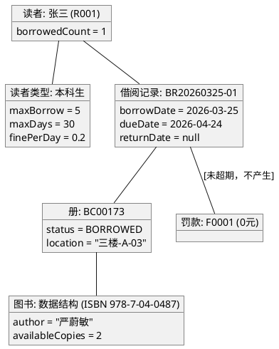

## 2.4 Sequence diagram（顺序图）

### 2.4.1 借书场景

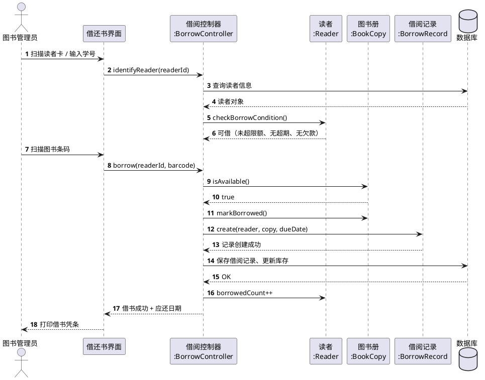

### 2.4.2 还书场景（含超期罚款）

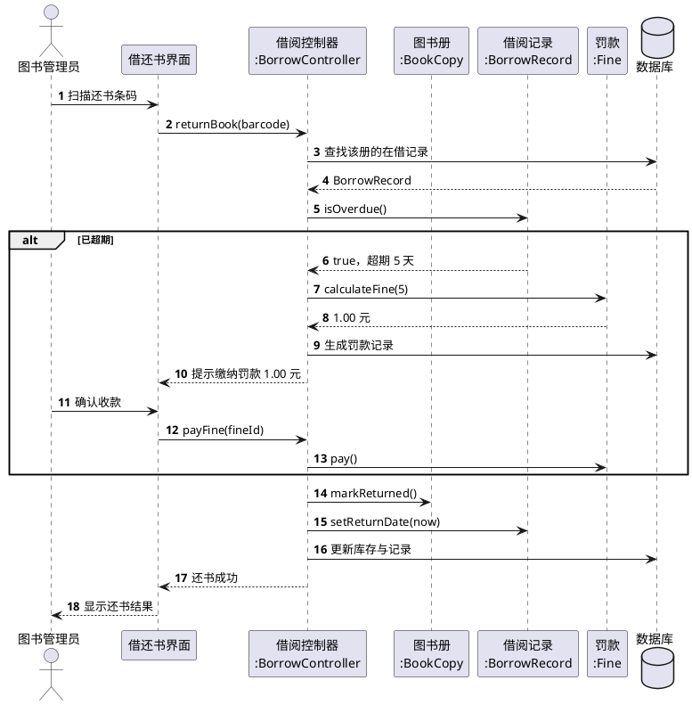

## 2.5 Activity diagram（活动图）

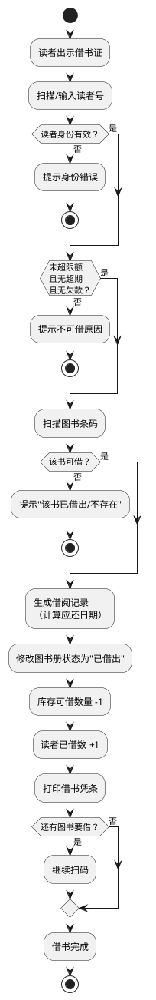

## 2.6 State diagram（状态图）

图书册（BookCopy）状态机：

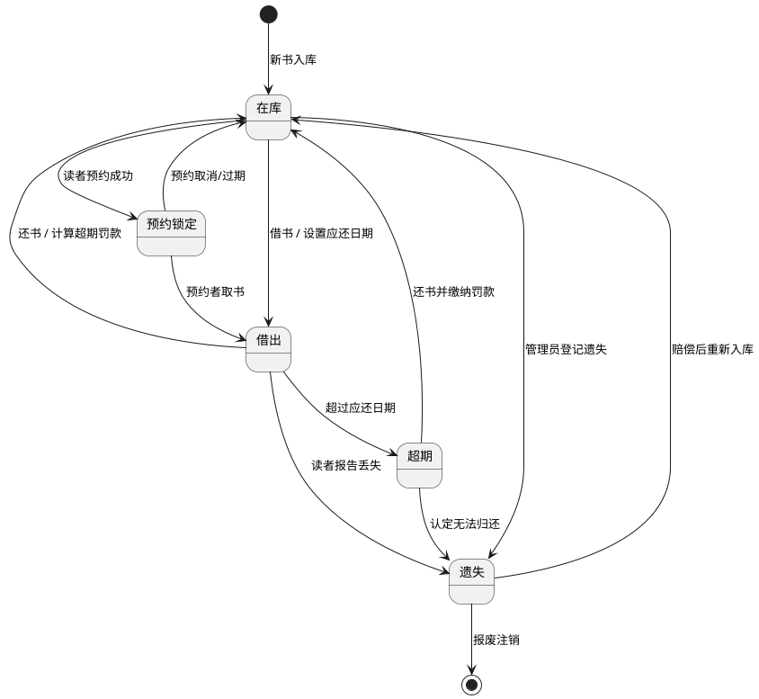

读者账户（Reader）状态机：

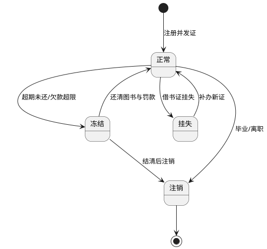

## 2.7 Component diagram（组件图）

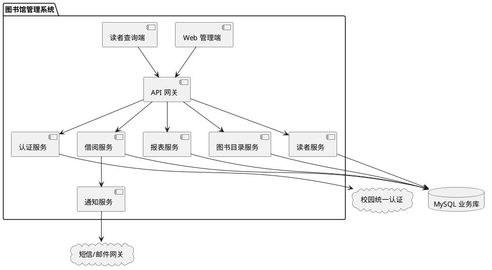

## 2.8 Deployment diagram（部署图）

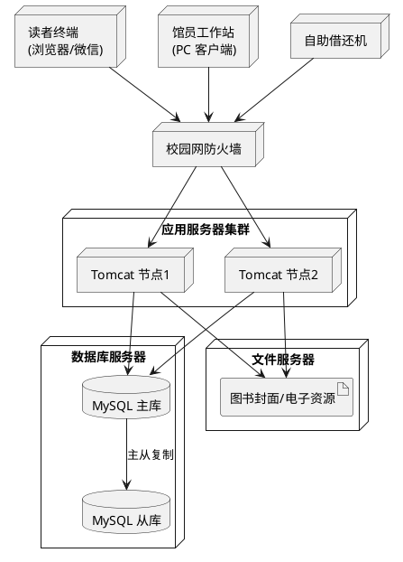

## 2.9 Timing diagram（时序图 / 时间图）

某图书册一天内的状态随时间变化：

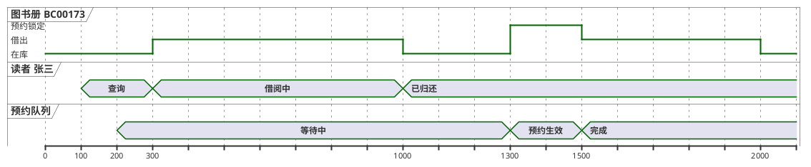

## 2.10 Legacy syntax（旧式语法示例）

> 说明：早期 PlantUML 使用 `Alice -> Bob : message` 这类简写；下面为兼容旧版渲染器的示例。

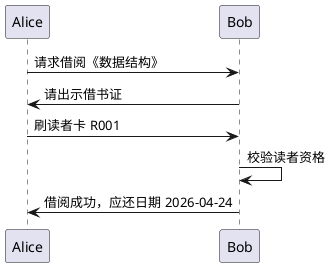

旧版的用例/类简写：

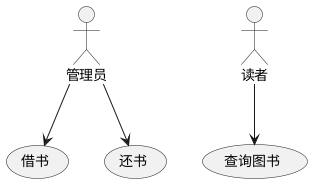

## 2.11 各图说明（文字补充）

| 图 | 作用 | 本系统要点 |
|---|---|---|
| 用例图 | 描述系统功能边界与参与者 | 三类角色：读者、图书管理员、系统管理员 |
| 类图 | 静态结构，类的属性/方法与关系 | 核心类 Reader、Book、BookCopy、BorrowRecord、Fine |
| 对象图 | 某一时刻的实例快照 | 展示张三借阅《数据结构》某一册的实例关系 |
| 顺序图 | 对象间按时间交互 | 借书、还书（含超期罚款分支） |
| 活动图 | 业务流程与控制流 | 借书全流程含判断分支 |
| 状态图 | 单个对象的状态迁移 | 图书册状态、读者账户状态 |
| 组件图 | 系统按功能拆分的构件与依赖 | 网关、认证、目录、借阅、报表服务 |
| 部署图 | 物理节点与部署 | 应用集群 + 数据库主从 + 文件服务器 |
| 时间图 | 状态随时间轴变化 | 一册书在一天内的在库/借出/预约变化 |
| 旧式语法 | 兼容旧渲染器的简写 | 顺序图与用例简写示例 |
