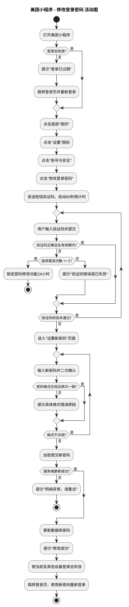
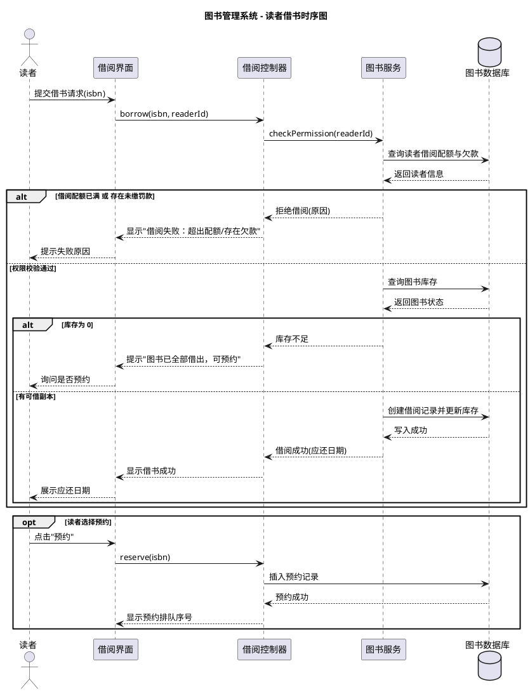
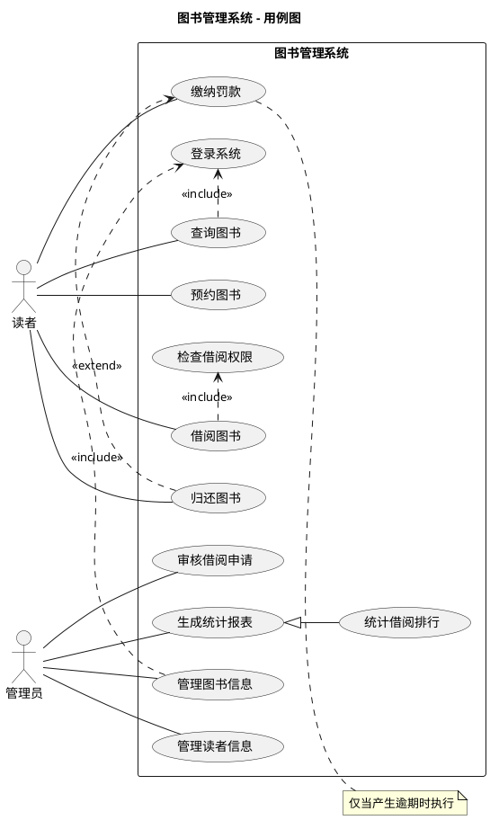
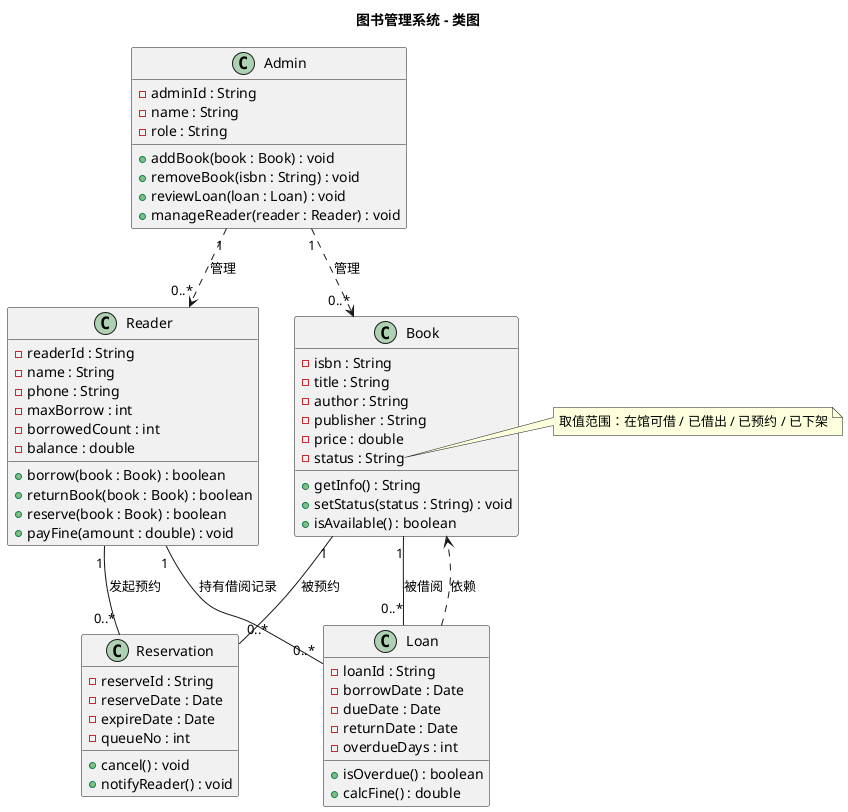
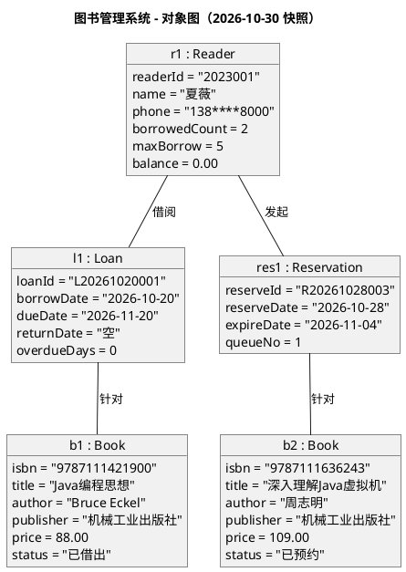
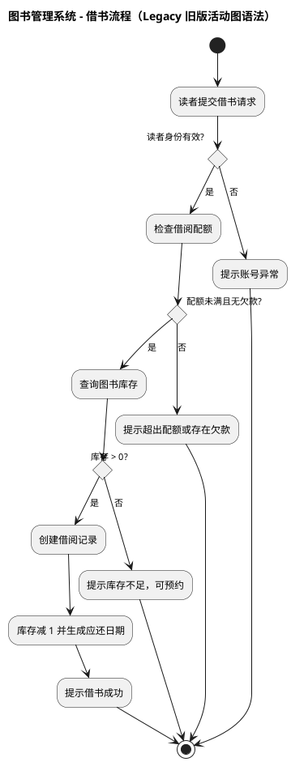
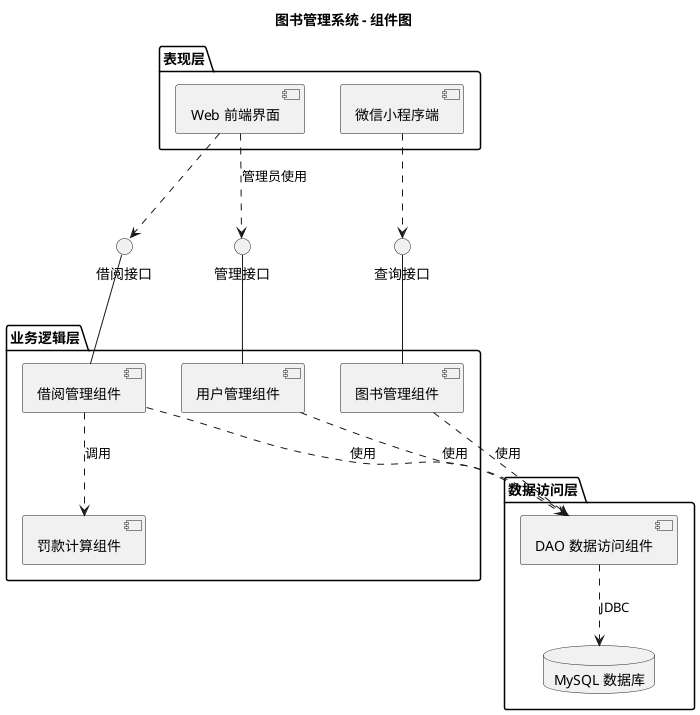
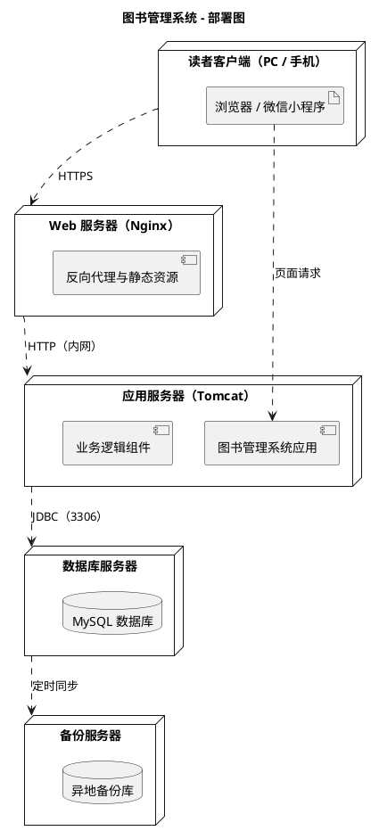
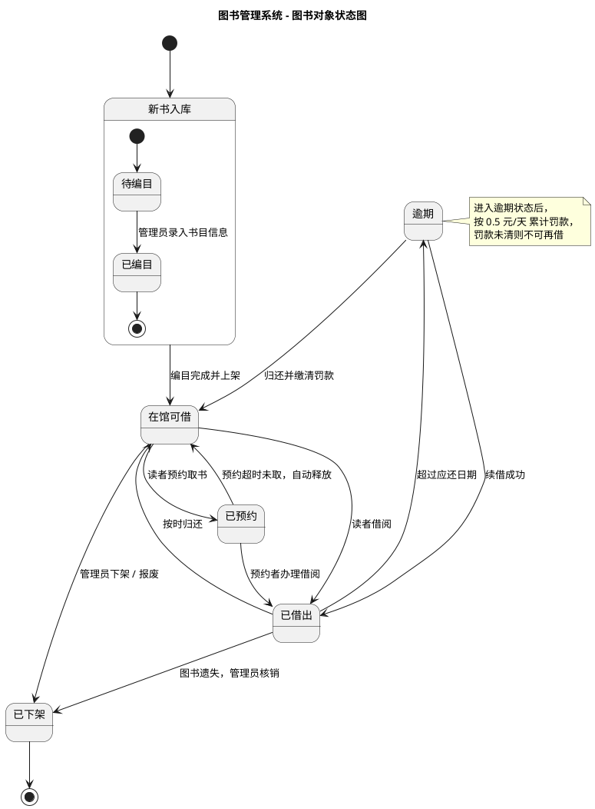
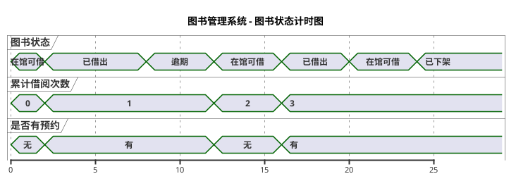

# 1030 实验报告

**学号：** 2503408019
**姓名：** 夏薇
**日期：** 1030

---

## 一、美团小程序「修改密码」操作事件流

### 1.1 用例说明

| 项目 | 内容 |
| --- | --- |
| **用例名称** | 修改登录密码 |
| **用例编号** | UC-01 |
| **参与者** | 美团用户（已注册并绑定手机号） |
| **系统** | 美团微信小程序 |
| **前置条件** | 用户已在微信中打开美团小程序，且账号处于已登录状态，绑定手机号可正常接收短信 |
| **后置条件** | 修改成功后账号密码被更新，当前登录态失效，需使用新密码重新登录 |
| **主事件流** | 基本事件流（B） |
| **备选/异常事件流** | A1～A3、E1～E2 |

### 1.2 基本事件流（B）

| 序号 | 参与者动作 | 系统响应 |
| --- | --- | --- |
| B1 | 用户在微信中打开「美团」小程序 | 系统加载首页，并校验本地登录态（token）是否有效 |
| B2 | — | 登录态有效，展示首页内容；登录态失效则转入 A1 |
| B3 | 用户点击底部导航栏「我的」 | 系统跳转至个人中心页面 |
| B4 | 用户点击页面右上角「设置」图标 | 系统进入设置页面 |
| B5 | 用户在设置列表中点击「账号与安全」 | 系统进入账号与安全页面，展示绑定手机号、登录密码、支付密码等条目 |
| B6 | 用户点击「修改登录密码」 | 系统校验账号安全等级，进入身份验证环节 |
| B7 | — | 系统向账号绑定的手机号发送短信验证码，页面进入验证码输入界面，同时启动 60 秒重发倒计时 |
| B8 | 用户查收短信并输入 6 位验证码，点击「下一步」 | 系统接收验证码并提交服务端校验 |
| B9 | — | 校验通过，系统跳转至「设置新密码」页面（校验失败转入 A2） |
| B10 | 用户输入新密码，并在确认框中再次输入 | 系统前端实时校验两次输入是否一致、是否满足格式要求（8～20 位，需同时包含字母和数字，不可与近期使用过的密码重复） |
| B11 | 用户点击「提交」 | 系统将新密码加密后提交服务端，更新数据库中的用户密码记录 |
| B12 | — | 系统返回「修改成功」，并使当前登录态失效 |
| B13 | — | 系统跳转至登录页面，提示用户使用新密码重新登录，用例结束 |

### 1.3 备选事件流

**A1：登录态失效**
1. 系统在 B2 检测到本地 token 已过期或不存在。
2. 系统弹出提示「登录已过期，请重新登录」，并跳转至登录页。
3. 用户完成登录后，系统返回步骤 B3，继续执行基本事件流。

**A2：验证码错误或超时**
1. 系统在 B9 校验发现验证码错误、或验证码已超过有效期（默认 5 分钟）。
2. 系统提示「验证码不正确或已失效，请重新获取」，并清空输入框。
3. 用户可在倒计时结束后点击「重新发送验证码」，系统重新发送短信，返回步骤 B8。
4. 若连续 5 次输入错误，系统锁定该账号的密码修改功能 24 小时，用例异常终止。

**A3：新密码格式不合规**
1. 系统在 B10 检测到密码长度不足 8 位、超过 20 位、缺少字母或数字、与旧密码相同，或与历史密码重复。
2. 系统在输入框下方以红色文字提示具体原因，例如「密码长度需为 8～20 位，且需包含字母和数字」。
3. 用户修改后重新提交，返回步骤 B11。

### 1.4 异常事件流

**E1：短信发送失败**
1. 在 B7 中，因手机号欠费、运营商拦截或触发平台风控导致短信发送失败。
2. 系统提示「验证码发送失败，请稍后重试」，并提供「语音验证码」作为替代验证方式。
3. 用户可选择重试或改用语音验证，成功则返回步骤 B8；多次失败则用例终止。

**E2：网络异常或服务端超时**
1. 在 B8 或 B11 提交请求时，网络中断或服务端响应超时。
2. 系统提示「网络连接异常，请检查网络后重试」，并保留用户已填写的内容。
3. 用户恢复网络后重新提交，系统从失败步骤继续执行。

### 1.5 特殊需求

1. **安全性**：新密码须经 HTTPS 加密传输，服务端以加盐哈希方式存储，全程不明文落库。
2. **时效性**：验证码有效期 5 分钟，重发间隔 60 秒，单日发送上限 10 次。
3. **安全性策略**：密码修改成功后，强制该账号在其他设备上的登录态失效，并推送「密码已修改」的安全提醒。
4. **可用性**：页面表单在校验失败时保留已填内容，避免用户重复输入。

### 1.6 事件流活动图（PlantUML）



---

## 二、图书管理系统 UML 建模

> 系统说明：系统面向两类用户——**读者**（查询、借阅、归还、预约、缴纳罚款）与**管理员**（图书信息维护、读者管理、借阅审核、统计报表）。
> 以下各图共用同一套核心类定义：`Book`、`Reader`、`Admin`、`Loan`、`Reservation`，保证模型前后一致。

### 2.1 Sequence diagram（时序图）



### 2.2 Use case diagram（用例图）



### 2.3 Class diagram（类图）



### 2.4 Object diagram（对象图）

> 说明：类图在某一时刻的实例快照，展示《Java编程思想》被读者"夏薇"借出的具体状态。



### 2.5 Activity diagram（活动图）

> 说明：使用 PlantUML 新版活动图语法（`start` / `stop` / `:` 标签 / `while` 循环），带泳道划分。

```plantuml
@startuml
title 图书管理系统 - 借书与还书活动图（新语法）
skinparam defaultFontName "Microsoft YaHei"

start

|读者|
:进入图书查询页;
:输入关键字检索图书;
:选择目标图书并提交借书请求;

|系统|
:接收借书请求;

if (读者身份有效?) then (否)
  :提示"账号异常，请联系管理员";
  stop
else (是)
endif

if (借阅配额未满且无欠款?) then (否)
  :提示"超出借阅配额或存在未缴罚款";
  stop
else (是)
endif

if (图书库存 > 0?) then (否)
  :提示"库存不足";
  fork
    :询问是否预约;
  fork again
    :推荐同类图书;
  end fork
  stop
else (是)
endif

:创建借阅记录;
:库存数量减 1;
:计算应还日期（借期 30 天）;
:提示借书成功;

|读者|
:在应还日期前归还图书;

|系统|
:扫码登记归还;
:库存数量加 1;

if (超过应还日期?) then (是)
  :计算逾期天数与罚款金额;
  while (罚款未缴清?) is (是)
    :提示缴纳罚款;
    :读者完成支付;
  endwhile (否)
else (否)
endif

:归还完成，图书状态置为"在馆可借";
stop

@enduml
```

### 2.6 Legacy syntax（传统/旧版语法示例）

> 说明：PlantUML 活动图存在两套语法。以下使用**传统（旧版）语法**绘制同一借书流程：
> 以 `(*)` 表示起止节点，用 `-->` 连接活动，用 `if ... then ... else ... endif` 表达分支，不使用 `start` / `stop` 与 `:` 标签语法。



**新旧语法对照（便于理解）：**

| 元素 | 新版语法（New） | 传统语法（Legacy） |
| --- | --- | --- |
| 开始 | `start` | `(*)` |
| 结束 | `stop` | `--> (*)` |
| 活动 | `:动作文字;` | `--> "动作文字"` |
| 分支 | `if (条件?) then (是) ... else (否) ... endif` | `if "条件?" then -->[是] ... else -->[否] ... endif` |
| 并行 | `fork ... fork again ... end fork` | `fork ... fork again ... end fork` |

### 2.7 Component diagram（组件图）



### 2.8 Deployment diagram（部署图）



### 2.9 State diagram（状态图）

> 说明：描述**单个 Book 对象**在其生命周期内的状态变化。



### 2.10 Timing diagram（计时图）

> 说明：描述图书状态与借阅次数随时间推移的变化情况（横轴为时间，纵轴为状态）。



