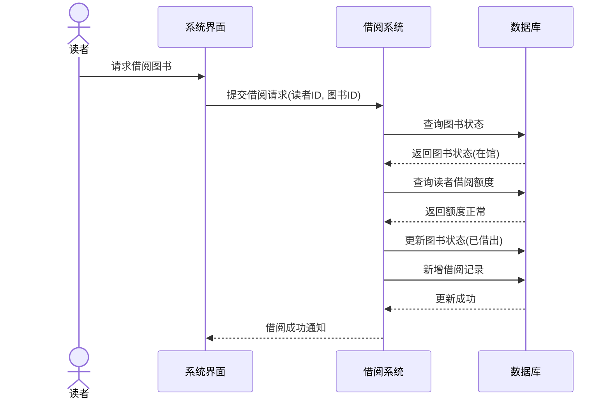
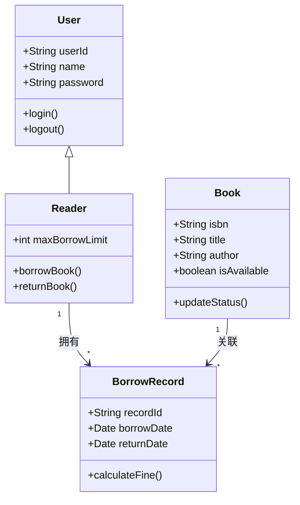
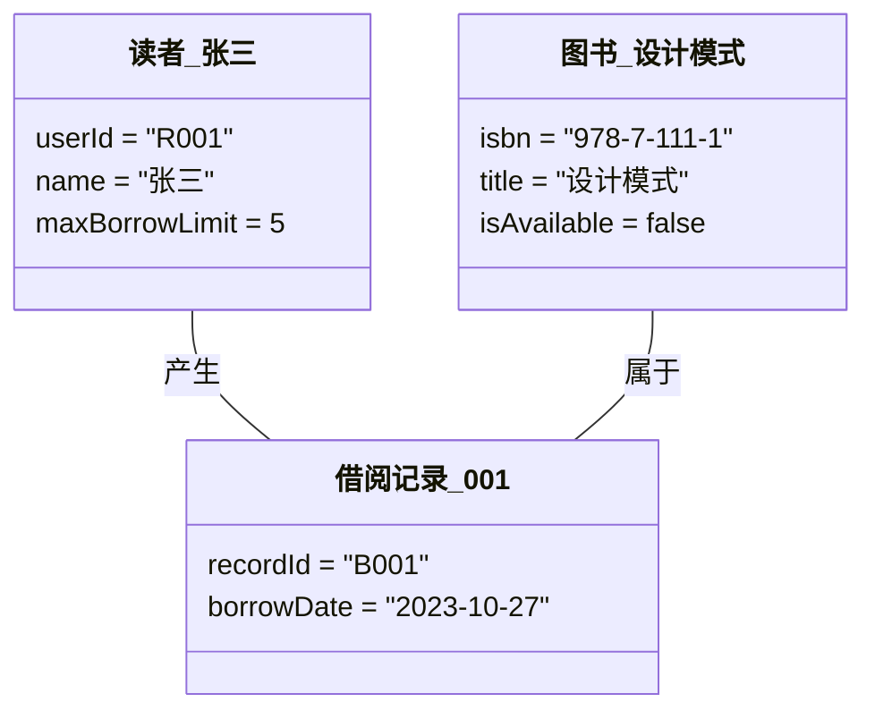
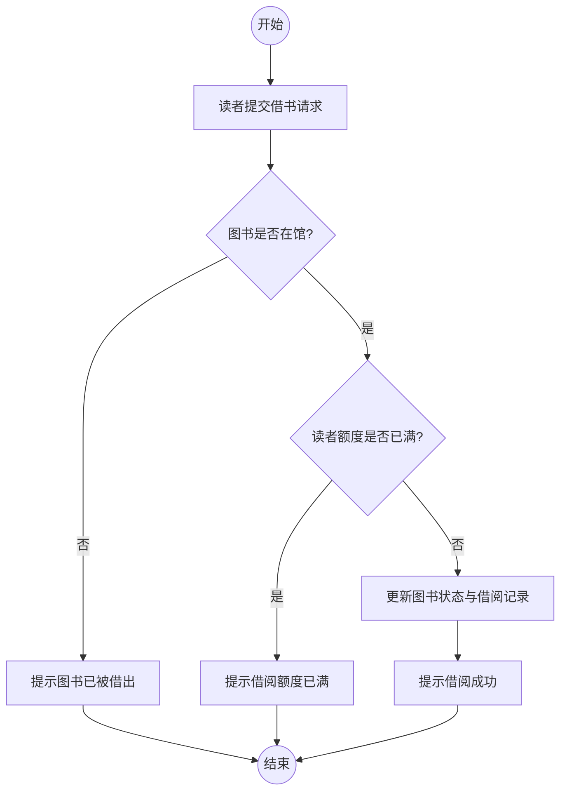
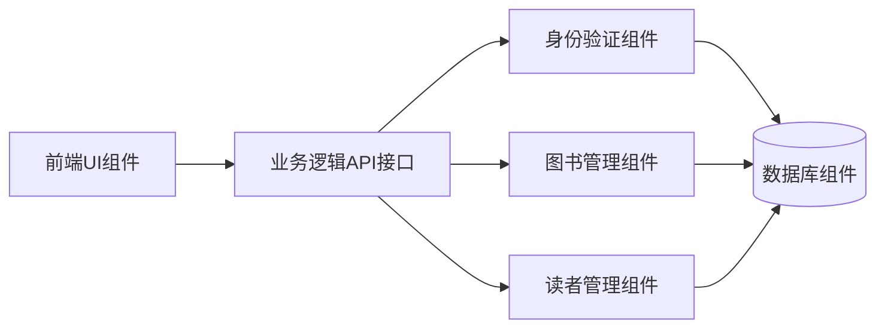
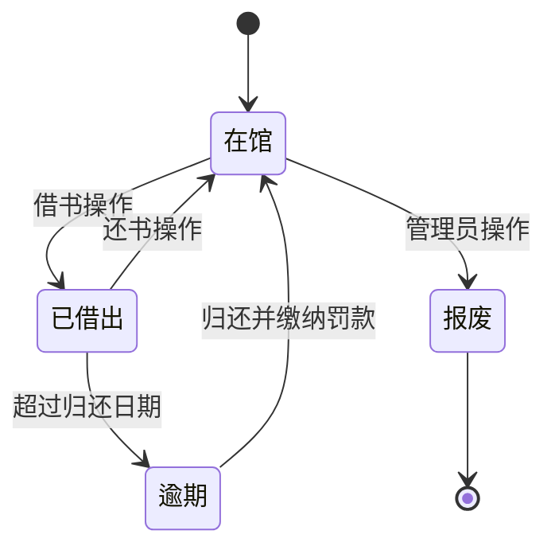
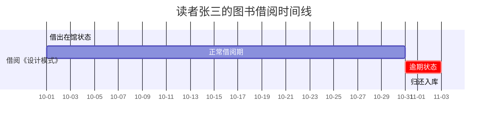

# 软件工程作业

## 1. 微信小程序修改用户名或密码的事件流

**场景选择**：某校园跑腿小程序（或常见的电商/外卖小程序）修改密码操作

**基本事件流（正常流程）**：
1. 用户进入小程序，点击“我的”页面。
2. 用户点击“设置” -> “账号与安全” -> 选择“修改密码”或“修改用户名”。
3. 系统弹出身份验证页面，要求用户输入原密码（或发送短信验证码进行验证）。
4. 用户输入原密码并点击“确认”。
5. 系统验证原密码正确，跳转至“设置新密码”页面。
6. 用户输入新密码及确认新密码，点击“提交”。
7. 系统检查新密码格式（如：长度8-16位，包含字母和数字），并确认两次输入一致。
8. 系统将新密码加密后提交至服务器更新。
9. 服务器返回更新成功提示。
10. 系统提示“修改成功”，并强制用户退出登录，需使用新密码重新登录。

**备选事件流（异常流程）**：
*   **4a. 原密码错误**：系统提示“原密码不正确，请重新输入”，返回步骤3。
*   **7a. 新密码格式不符**：系统提示“密码格式需包含字母和数字”，停留在当前页面。
*   **7b. 两次密码不一致**：系统提示“两次输入的密码不一致”，停留在当前页面。
*   **8a. 网络异常**：服务器无响应，系统提示“网络异常，请稍后重试”。

---

## 2. 图书馆管理系统 UML 图

*(注：以下图表均使用 Mermaid 语法生成，在支持 Mermaid 的 Markdown 阅读器中可直接显示为图形)*

### 2.1 Sequence diagram (顺序图 - 以借书为例)

### 2.2 Use case diagram (用例图)

```mermaid
usecaseDiagram
    actor 读者 as Reader
    actor 图书管理员 as Admin

    Reader --> (登录系统)
    Reader --> (查询图书)
    Reader --> (借阅图书)
    Reader --> (归还图书)
    Reader --> (查看借阅历史)

    Admin --> (登录系统)
    Admin --> (录入新书)
    Admin --> (删除图书)
    Admin --> (管理读者信息)
    Admin --> (处理逾期罚款)
```

### 2.3 Class diagram (类图)



### 2.4 Object diagram (对象图)



### 2.5 Activity diagram (活动图 - 以借书流程为例)



### 2.6 Component diagram (组件图)



### 2.7 Deployment diagram (部署图)

```mermaid
flowchart TD
    subgraph Client [客户端环境]
        Browser[Web浏览器/小程序]
    end
    
    subgraph Server [服务器环境]
        WebServer[Web应用服务器<br/>(Nginx/Tomcat)]
        AppServer[后端应用服务器<br/>(Spring Boot/Node.js)]
    end
    
    subgraph DataCenter [数据中心]
        Database[(MySQL 数据库)]
    end
    
    Browser -- HTTP/HTTPS --> WebServer
    WebServer --> AppServer
    AppServer -- JDBC/SQL --> Database
```

### 2.8 State diagram (状态图 - 图书状态)



### 2.9 Timing diagram (时间图 - 借阅周期)



```