# 软件工程作业：事件流分析与 UML 建模

| 项目 | 内容 |
| --- | --- |
| 学号 | 2503408055 |
| 姓名 | 魏佳琪 |
| 日期 | 2026.10.30 |
| 任务一 | 茉酸奶点单微信小程序「修改用户名 / 修改密码」事件流分析与流程图 |
| 任务二 | 图书馆管理系统 UML 图集（用例图、类图、对象图、序列图、活动图、状态图、时序图、组件图、部署图、Legacy Syntax 图） |

> **绘图约定**：本文所有图均使用 Mermaid 语法内嵌于 Markdown，可直接在 GitHub 上渲染，无需额外插件。Mermaid 原生不支持的 UML 图（用例图、对象图、时序图、组件图、部署图）采用其图元近似表达，并在图下注明近似方式与语义偏差；附录 A 同时给出对应的 PlantUML 源码，供需要严格 UML 语义时导入使用。

---

## 目录

- [任务一 茉酸奶点单小程序事件流分析](#任务一-茉酸奶点单小程序修改用户名--修改密码事件流分析)
  - [1.1 分析对象与前提说明](#11-分析对象与前提说明)
  - [1.2 分析方法](#12-分析方法)
  - [1.3 参与者与涉众](#13-参与者与涉众)
  - [1.4 用例规约 UC-01 修改用户名](#14-用例规约-uc-01修改用户名)
  - [1.5 用例规约 UC-02 修改密码](#15-用例规约-uc-02修改密码)
  - [1.6 事件清单](#16-事件清单)
  - [1.7 界面元素-事件对照表](#17-界面元素-事件对照表)
  - [1.8 流程图](#18-流程图)
  - [1.9 状态变化分析](#19-状态变化分析)
  - [1.10 风险与改进建议](#110-风险与改进建议)
- [任务二 图书馆管理系统 UML 建模](#任务二-图书馆管理系统-uml-建模)
  - [2.1 系统概述与建模约定](#21-系统概述与建模约定)
  - [2.2 用例图](#22-用例图)
  - [2.3 类图](#23-类图)
  - [2.4 对象图](#24-对象图)
  - [2.5 序列图](#25-序列图)
  - [2.6 活动图](#26-活动图)
  - [2.7 状态图](#27-状态图)
  - [2.8 时序图](#28-时序图timing-diagram)
  - [2.9 组件图](#29-组件图)
  - [2.10 部署图](#210-部署图)
  - [2.11 Legacy Syntax 图](#211-legacy-syntax-图)
  - [2.12 模型一致性说明](#212-模型一致性说明)
- [附录 A PlantUML 源码](#附录-a-plantuml-源码)
- [附录 B 图目录](#附录-b-图目录)

---

# 任务一 茉酸奶点单小程序「修改用户名 / 修改密码」事件流分析

## 1.1 分析对象与前提说明

**分析对象**：茉酸奶（More Yogurt）微信点单小程序中，「我的 → 个人资料 / 账号与安全」下修改昵称（用户名）与修改登录密码两项操作。

**前提说明（重要）**：该小程序的源码与后端接口未公开，本文分析基于两条依据——① 小程序的公开交互界面（点单、个人中心、设置页）可观察到的页面跳转与提示文案；② 现制饮品点单类小程序的通行实现模式（微信授权登录 + 手机号绑定 + 会员体系）。

因此文中把结论分为两类：

- **可观察事实**：页面结构、按钮位置、交互结果（如"昵称不能为空""密码为 8-20 位"等提示）；
- **【推断】**：不可直接观察的后端接口、校验规则、风控阈值等，按行业通用做法合理推断。

标注【推断】的部分不代表该小程序一定如此实现，仅作为事件流建模的合理补全。

## 1.2 分析方法

事件流（Event Flow）描述**参与者与系统之间按时间顺序发生的一次完整交互**，是连接"用例"与"系统内部行为"的桥梁。按 UML / 用例建模惯例，一条完整的事件流由三部分组成：

| 组成 | 含义 | 本文对应 |
| --- | --- | --- |
| 基本流（Basic Flow） | 一切顺利时的主干路径，无任何异常 | 1.4.2、1.5.2 |
| 备选流（Alternate Flow） | 合法但非主干的路径，如用户中途取消、选择了另一种方式 | 1.4.3、1.5.3 |
| 异常流（Exception Flow） | 出错路径，如校验失败、网络超时、权限不足 | 1.4.4、1.5.4 |

本文采用的事件描述格式为：**「触发者 → 系统响应」** 的对偶句式，每一步都包含"谁做了什么"和"系统做了什么反应"，避免只写用户动作而遗漏系统响应。

## 1.3 参与者与涉众

### 1.3.1 主要参与者

| 参与者 | 类型 | 说明 |
| --- | --- | --- |
| 会员用户（C 端） | 主要参与者 | 已注册并登录小程序的消费者，发起修改操作 |
| 微信客户端 | 支撑参与者 | 提供 `wx.login` 静默登录、`openid` 身份标识、授权昵称/头像能力 |
| 小程序前端 | 系统边界内 | 渲染页面、做第一道本地校验、发起网络请求 |
| 用户服务（后端） | 系统边界内 | 处理资料更新、密码校验、令牌签发与失效 |
| 短信服务 | 外部系统 | 下发验证码，用于修改密码前的身份核验【推断】 |
| 会员数据库 | 系统边界内 | 持久化昵称、密码哈希、修改流水 |

### 1.3.2 涉众关注点

| 涉众 | 关注点 |
| --- | --- |
| 用户 | 操作路径短、失败有明确原因、改完立刻生效 |
| 运营 | 昵称需过滤违规词，避免公开展示（如订单、评价、排行榜）时出现不当内容 |
| 安全 / 风控 | 密码修改必须强身份核验；改密后旧会话必须失效 |
| 客服 | 改密失败、账号被锁定时有可查的流水与提示话术 |

## 1.4 用例规约 UC-01：修改用户名（昵称）

### 1.4.1 用例基本信息

| 项 | 内容 |
| --- | --- |
| 用例编号 | UC-01 |
| 用例名称 | 修改用户名（昵称） |
| 用例简述 | 用户在小程序中把展示用的昵称改为新的昵称，系统校验合法性后持久化并刷新界面 |
| 参与者 | 会员用户（主）、微信客户端（支撑） |
| 触发事件 | 用户在「个人资料」页点击昵称项并在编辑框中点击"保存" |
| 前置条件 | ① 用户已进入小程序且登录态（token）有效；② 账号已完成手机号绑定；③ 账号状态正常（未封禁） |
| 后置条件 | 成功：昵称字段更新，`profile_update_time` 刷新，个人中心与订单页展示同步更新 失败：昵称保持原值，无副作用，用户可重试 |
| 关联用例 | UC-00 微信授权登录（被 include）、UC-03 修改密码（无直接关系） |
| 频度 | 低频（多数产品设置 30 天冷却期）【推断】 |

### 1.4.2 基本事件流（Basic Flow）

| 步 | 触发者 | 事件 | 系统响应 |
| --- | --- | --- | --- |
| 1 | 用户 | 点击底部「我的」Tab | 前端携带 token 请求 `GET /user/profile`，返回昵称、头像、脱敏手机号、会员等级、储值余额 |
| 2 | 用户 | 点击头像 / 昵称区域 | 路由跳转至「个人资料」页，回显当前昵称、头像、会员编号 |
| 3 | 用户 | 点击"昵称"一行 | 弹出编辑态（底部弹层或独立编辑页），输入框自动聚焦并预填当前昵称，光标置于末尾 |
| 4 | 用户 | 输入新昵称，点击"保存" | 前端先做本地校验（见 1.4.2 校验规则表） |
| 5 | 前端 | 校验通过，提交 `PUT /user/profile/nickname`，body：`{nickname, version}` | 网关校验 token 有效性 → 用户服务执行服务端校验（见校验规则表） |
| 6 | 用户服务 | 服务端校验全部通过 | 开启事务：更新 `member.nickname`、`profile_update_time`；写入 `member_profile_log` 流水（旧值、新值、客户端 IP、设备号、时间） |
| 7 | 用户服务 | 事务提交成功 | 返回 `200 {code:0, data:{nickname, updateTime}}` |
| 8 | 前端 | 收到成功响应 | 关闭编辑态 → 更新本地缓存与全局状态（如 Pinia/Vuex store）→ 个人资料页与「我的」页昵称同步刷新 |
| 9 | 系统 | — | Toast 提示"昵称修改成功"；若订单页、评价页存在昵称展示，则下次拉取时取新值 |
| 10 | 用户 | — | 用例结束，系统回到「个人资料」页 |

**校验规则表（前端 + 后端双重校验）**

| 校验项 | 规则 | 触发方 | 提示文案（示意） |
| --- | --- | --- | --- |
| 非空 | 去掉首尾空白后长度 > 0 | 前端 + 后端 | 昵称不能为空 |
| 长度 | 2–20 个字符（中文按 1 个字符计） | 前端 + 后端 | 昵称需为 2–20 个字符 |
| 字符集 | 中文、英文、数字、下划线，禁止 emoji 与特殊符号 | 前端 | 仅支持中英文、数字和下划线 |
| 敏感词 | 命中运营维护的敏感词库则拒绝 | 后端（唯一可信来源） | 昵称包含违规内容，请重新输入 |
| 重复度 | 与原昵称相同则视为无效提交 | 前端 | 新昵称与当前昵称相同 |
| 频次 | 距上次修改需满 30 天（可配置）【推断】 | 后端 | 昵称 30 天内仅可修改一次 |
| 唯一性 | 昵称一般不唯一（仅作展示），故不校验唯一 | 后端 | — |

### 1.4.3 备选流（Alternate Flow）

| 编号 | 分支点 | 条件 | 处理 |
| --- | --- | --- | --- |
| A1 | 步骤 1 之前 | 用户未登录或 token 已过期 | 前端拦截 401 → 触发 `wx.login` 静默登录 → 用 code 换取会话 → 若为首次进入则跳「手机号授权 + 注册」→ 完成后回到原页面继续 |
| A2 | 步骤 3 之后 | 用户点击"取消"或点击遮罩关闭弹层 | 编辑态关闭，不提交请求，昵称保持原值，无任何数据变更 |
| A3 | 步骤 4 | 用户想用微信授权头像/昵称一键填充 | 调用 `wx.getUserProfile` 获取微信昵称作为输入框默认值，用户可再修改后保存（仅填充，不直接提交） |
| A4 | 步骤 6 | 同一账号在另一台设备已修改过昵称（乐观锁 `version` 冲突） | 返回 `409`，前端提示"昵称已在其他设备修改，请刷新后重试"，并自动重新拉取最新资料 |
| A5 | 步骤 8 | 修改的是头像而非昵称 | 走独立的"上传头像"链路：`wx.chooseMedia` → 压缩 → 上传对象存储 → 回传 CDN URL → `PUT /user/profile/avatar`，与昵称互不影响 |

### 1.4.4 异常流（Exception Flow）

| 编号 | 异常场景 | 系统行为 | 用户可见结果 |
| --- | --- | --- | --- |
| E1 | 前端校验不通过（长度/字符集/与原值相同） | 阻止请求发出，输入框下方内联红字提示，输入框保持编辑态 | 就地看到错误原因，光标不丢失 |
| E2 | 后端敏感词命中，返回 `4001` | 事务不开启，写风控日志（便于运营复审） | 提示"昵称包含违规内容" |
| E3 | 超出修改频次，返回 `4002` | 返回下次可修改时间 | 提示"昵称 30 天内仅可修改一次，下次可改时间 2026-11-29" |
| E4 | token 失效，返回 `401` | 清除本地登录态 | 自动跳转登录，登录后回到「个人资料」页（登录前已填内容不保留） |
| E5 | 数据库更新失败（连接超时/死锁） | 事务回滚，`nickname` 保持旧值 | 提示"修改失败，请稍后重试"，按钮恢复可点击 |
| E6 | 网络中断 / 请求超时 | 前端 3 次指数退避重试；仍失败则回滚乐观更新的 UI | 提示"网络异常"，界面昵称回退到旧值，不出现"显示已改、实际未改"的脏数据 |
| E7 | 账号被封禁 / 注销中 | 网关层拦截，返回 `403` | 提示"账号状态异常，请联系客服" |
| E8 | 服务端已更新但响应丢失（超时但写入成功） | 重试时后端做幂等判断（新旧值相同则直接返回成功） | 用户看到"修改成功"，不产生重复流水的错觉 |

## 1.5 用例规约 UC-02：修改密码

### 1.5.1 用例基本信息

| 项 | 内容 |
| --- | --- |
| 用例编号 | UC-02 |
| 用例名称 | 修改登录密码 |
| 用例简述 | 用户通过原密码 + 短信验证码双因子核验后，设置新的登录密码，并使旧会话失效 |
| 参与者 | 会员用户（主）、短信服务（支撑）、微信客户端（支撑） |
| 触发事件 | 用户在「账号与安全」页点击"修改登录密码"并提交新密码 |
| 前置条件 | ① 已登录；② 已绑定可用手机号；③ 该账号已设置过密码（否则走"设置密码"分支） |
| 后置条件 | 成功：密码哈希更新，`pwd_update_time` 刷新，全部旧 token 失效，用户需重新登录 失败：原密码与登录态均不变 |
| 特殊说明 | 该小程序主登录方式为「微信授权 + 手机号验证码」，**密码多用于 H5/客服端/储值卡场景**；若账号从未设置密码，则界面不展示"修改密码"而展示"设置密码"【推断】 |

### 1.5.2 基本事件流（Basic Flow）

| 步 | 触发者 | 事件 | 系统响应 |
| --- | --- | --- | --- |
| 1 | 用户 | 进入「我的」→「设置」→「账号与安全」 | 请求 `GET /user/security`，返回脱敏手机号（138****6688）、密码是否已设置、最近登录设备 |
| 2 | 用户 | 点击"修改登录密码" | 前端判断 `hasPassword`：为 true 进入"验证身份"页；为 false 进入"设置密码"页（备选流 A1） |
| 3 | 用户 | 在原密码输入框输入当前密码 | 前端仅做格式校验（8–20 位），不在本地判断对错 |
| 4 | 用户 | 点击"获取验证码" | 前端校验手机号存在 → 调 `POST /sms/code`，场景参数 `scene=modify_pwd`；后端限频：同一手机号 60 秒 1 条、每日 10 条 |
| 5 | 短信服务 | 下发 6 位数字验证码 | 验证码写入 Redis，`key = sms:modify_pwd:{phone}`，TTL 5 分钟；错误次数计数器初始化为 0 |
| 6 | 用户 | 输入验证码、新密码、确认新密码，点击"确认修改" | 前端校验：两次输入一致、长度 8–20、必须同时含字母与数字、新密码 ≠ 原密码 |
| 7 | 前端 | 校验通过，提交 `PUT /user/password`，body：`{oldPwd, smsCode, newPwd, deviceId}` | 网关校验 token → 用户服务依次执行：验证码比对 → 原密码比对（`bcrypt.compare`）→ 新密码强度校验 → 新密码与历史密码比对 |
| 8 | 用户服务 | 全部校验通过 | 开启事务：更新 `member.password_hash`、`pwd_update_time`；删除该用户全部 refresh token 及 Redis 会话；写 `password_change_log`（不含明文/哈希，仅记录时间、IP、设备） |
| 9 | 用户服务 | 事务提交成功 | 返回 `200 {code:0}`，响应头带 `Clear-Session: true` |
| 10 | 前端 | 收到成功响应 | 清除本地 token、用户缓存、页面栈；跳转登录页 |
| 11 | 系统 | — | 提示"密码修改成功，请使用新密码重新登录"；同时向绑定手机号发送安全通知短信"您的密码于 xx 时间被修改，非本人操作请联系客服" |
| 12 | 用户 | 用新密码登录 | 登录成功，用例结束 |

### 1.5.3 备选流（Alternate Flow）

| 编号 | 分支点 | 条件 | 处理 |
| --- | --- | --- | --- |
| A1 | 步骤 2 | 账号从未设置过密码（`hasPassword = false`） | 走"设置密码"支线：无需原密码，仅需短信验证码 + 新密码，其余校验一致 |
| A2 | 步骤 2 | 用户忘记原密码 | 提供"忘记密码"入口 → 走找回流程（手机号验证码 + 实名信息核验），而非本用例 |
| A3 | 步骤 4 | 用户在 60 秒内再次点击获取 | 按钮进入倒计时（59s）且处于 disabled 态，请求不发出；若被绕过则后端返回 `429` |
| A4 | 步骤 4 | 用户手机号已停用，需先换绑 | 引导至"更换手机号"用例，换绑成功后回到本用例 |
| A5 | 步骤 6 | 用户中途返回上一页 / 杀进程 | 已下发的验证码自然过期（5 min），不产生任何数据变更，无副作用 |
| A6 | 步骤 7 | 用户在同一账号的多个设备登录 | 密码修改成功后，**所有设备**（含当前设备）会话失效；如需保留当前设备，可在产品上改为"仅失效其他设备"【推断】 |

### 1.5.4 异常流（Exception Flow）

| 编号 | 异常场景 | 系统行为 | 用户可见结果 |
| --- | --- | --- | --- |
| E1 | 原密码输入错误 | 错误计数 +1；**连续 5 次**错误则锁定该账号改密入口 30 分钟【推断】 | 提示"原密码错误，还可尝试 4 次"；锁定后提示剩余解锁时间 |
| E2 | 验证码错误 | Redis 错误计数 +1，超过 5 次该验证码立即作废 | 提示"验证码错误"；作废后需重新获取 |
| E3 | 验证码过期（> 5 min） | 校验失败，不消耗错误次数 | 提示"验证码已过期，请重新获取" |
| E4 | 两次新密码不一致 | 前端拦截，不发请求 | 确认框下方红字"两次输入的密码不一致" |
| E5 | 新密码强度不足 | 前端实时提示 + 后端兜底拒绝 | 提示"密码需为 8–20 位且同时包含字母和数字" |
| E6 | 新密码与原密码相同 | 后端拒绝（防"假修改"） | 提示"新密码不能与原密码相同" |
| E7 | 新密码命中历史密码库 | 后端拒绝（可配置保留最近 3 次）【推断】 | 提示"不能使用近期使用过的密码" |
| E8 | 短信通道故障，验证码下发失败 | `POST /sms/code` 返回 `503`，记录告警 | 提示"验证码发送失败，请稍后重试"，并保留"语音验证码"备选入口 |
| E9 | 更新密码时数据库异常 | 事务回滚，密码与登录态均不变 | 提示"修改失败，请稍后重试"，已填内容保留 |
| E10 | 改密成功后前端跳转失败（弱网） | 清 token 已在本地完成，下次唤醒小程序时按未登录处理 | 用户重进小程序即处于登录页，不出现"半登录"状态 |

## 1.6 事件清单

把上述两条事件流拆成原子事件，便于后续做接口设计与测试用例设计。

| 事件编号 | 事件名 | 触发者 | 目标对象 | 携带数据 | 期望响应 |
| --- | --- | --- | --- | --- | --- |
| EV-01 | 进入个人中心 | 用户 | 前端路由 | token | 渲染资料页 |
| EV-02 | 拉取个人资料 | 前端 | 用户服务 | token | 昵称/头像/手机号/等级 |
| EV-03 | 打开昵称编辑态 | 用户 | 前端组件 | 当前昵称 | 弹出输入框 |
| EV-04 | 提交昵称 | 用户 | 前端校验器 | 新昵称 | 通过 / 内联报错 |
| EV-05 | 请求修改昵称 | 前端 | 用户服务 | nickname, version | 200 / 4001 / 4002 / 409 |
| EV-06 | 写昵称变更流水 | 用户服务 | 数据库 | 旧值、新值、IP、设备 | 插入成功 |
| EV-07 | 刷新全局昵称 | 用户服务 → 前端 | 前端全局状态 | 新昵称 | UI 同步更新 |
| EV-08 | 进入账号与安全 | 用户 | 前端路由 | token | 脱敏手机号、hasPassword |
| EV-09 | 请求短信验证码 | 用户 | 用户服务 → 短信服务 | phone, scene | 下发成功 / 429 |
| EV-10 | 校验验证码 | 用户服务 | Redis | phone, code | 通过 / 错误 / 过期 |
| EV-11 | 校验原密码 | 用户服务 | 数据库 | oldPwd | 通过 / 错误计数 +1 |
| EV-12 | 校验新密码强度 | 用户服务 | 规则引擎 | newPwd, 历史哈希 | 通过 / 拒绝 |
| EV-13 | 更新密码哈希 | 用户服务 | 数据库 | newHash | 事务提交 |
| EV-14 | 失效全部会话 | 用户服务 | Redis / token 库 | userId | token 全部删除 |
| EV-15 | 发送安全通知 | 用户服务 | 短信服务 | userId, 时间, 设备 | 通知下发 |
| EV-16 | 强制重新登录 | 前端 | 登录页 | — | 清空本地状态并跳转 |

## 1.7 界面元素-事件对照表

用于验收测试时逐项核对"界面上的每个可点区域是否都有对应事件"。

| 页面 | 界面元素 | 交互 | 触发事件 | 关联用例 |
| --- | --- | --- | --- | --- |
| 我的 | 头像 / 昵称行 | 单击 | EV-03 | UC-01 |
| 个人资料 | 昵称输入框 | 输入 | 实时长度提示（剩余字数） | UC-01 |
| 个人资料 | "保存"按钮 | 单击 | EV-04 → EV-05 | UC-01 |
| 个人资料 | 返回箭头 | 单击 | 放弃编辑（A2） | UC-01 |
| 设置 | "账号与安全" | 单击 | EV-08 | UC-02 |
| 账号与安全 | "修改登录密码" | 单击 | 路由到验证身份页 | UC-02 |
| 验证身份 | "获取验证码" | 单击 | EV-09 | UC-02 |
| 验证身份 | 6 位验证码输入框 | 输入 | 自动跳格、满 6 位自动聚焦下一项 | UC-02 |
| 验证身份 | 密码输入框（眼睛图标） | 单击 | 明文/密文切换 | UC-02 |
| 验证身份 | "确认修改" | 单击 | EV-10 → EV-11 → EV-12 → EV-13 | UC-02 |

## 1.8 流程图

### 图 1-1 修改用户名（昵称）事件流流程图

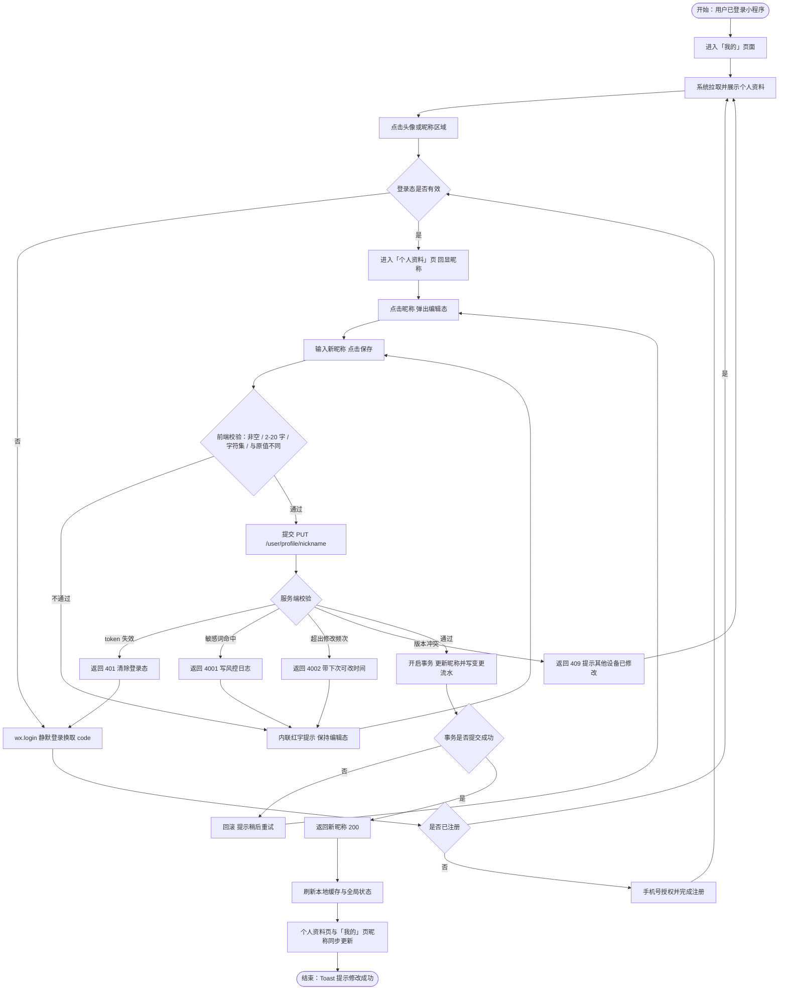

**图注**：菱形为判定节点，`E`、`I`、`K`、`M` 四层判定分别对应"身份有效性 → 前端合法性 → 服务端业务规则 → 持久化结果"，这是典型的四层拦截结构；任何一层失败都不会污染数据库。

### 图 1-2 修改登录密码（一）——身份核验阶段

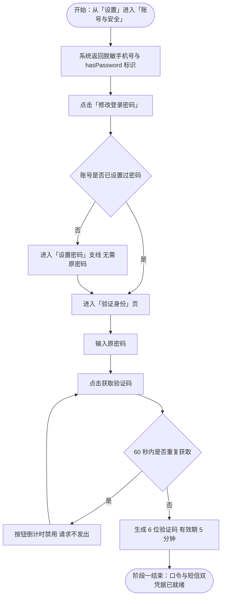

**图注**：这一阶段只做一件事——证明"操作者既是账号本人在用设备，也掌握绑定手机"。原密码和短信验证码构成双因子，缺一不可；`hasPassword=false` 的账号走左边的支线，因为纯验证码登录的用户从来没有设过密码，强求原密码等于把用户挡在门外。

### 图 1-3 修改登录密码（二）——设置新密码与生效

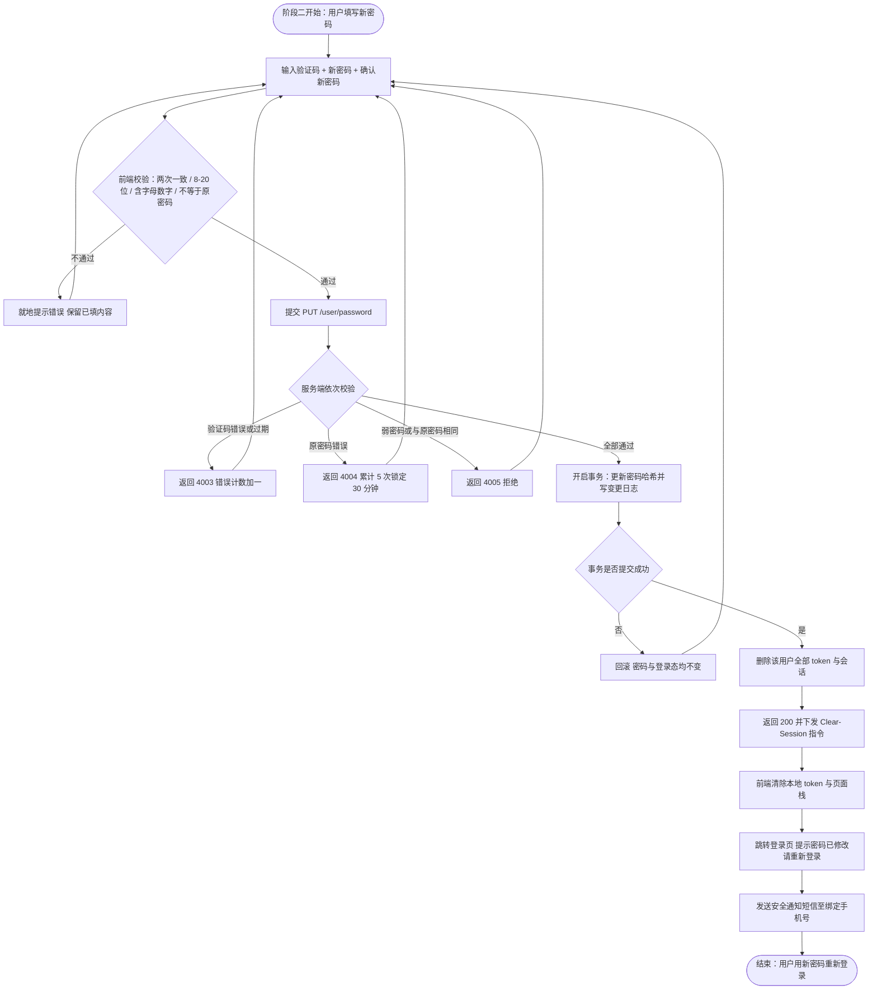

**图注**：修改密码的主干链路有 **"三校验一事务"** 的结构——验证码校验（证明手机在你手上）、原密码校验（证明旧凭据在你手上）、强度校验（保证新凭据合格），最后用一个事务同时完成"改密 + 会话失效"。会话失效不是可选项：如果只改密码不清 token，攻击者持有的旧 token 仍可继续使用，改密就形同虚设。

把这条链路拆成两图，只是因为它在纸面上太长（二十多个节点纵向排开，A4 一页放不下会被压到看不清）；逻辑上它仍是一条连续的事件流，阶段一结束时的"凭据就绪"就是阶段二的入口条件。

### 图 1-4 修改操作的前后端事件交互序列图

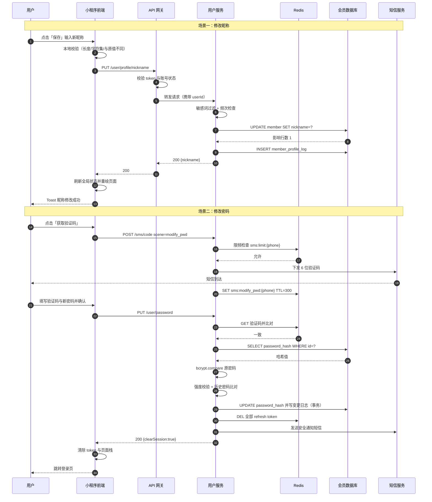

**图注**：这张图把两条事件流放在同一时序里对照，可以看出改昵称是"单次请求单次落库"的轻操作，改密码是"先申请凭据、后核验提交"的两阶段操作，这也是两者的根本差异。

## 1.9 状态变化分析

修改操作虽然只改变一个字段，但会牵动若干状态标志，用状态迁移描述更清楚：

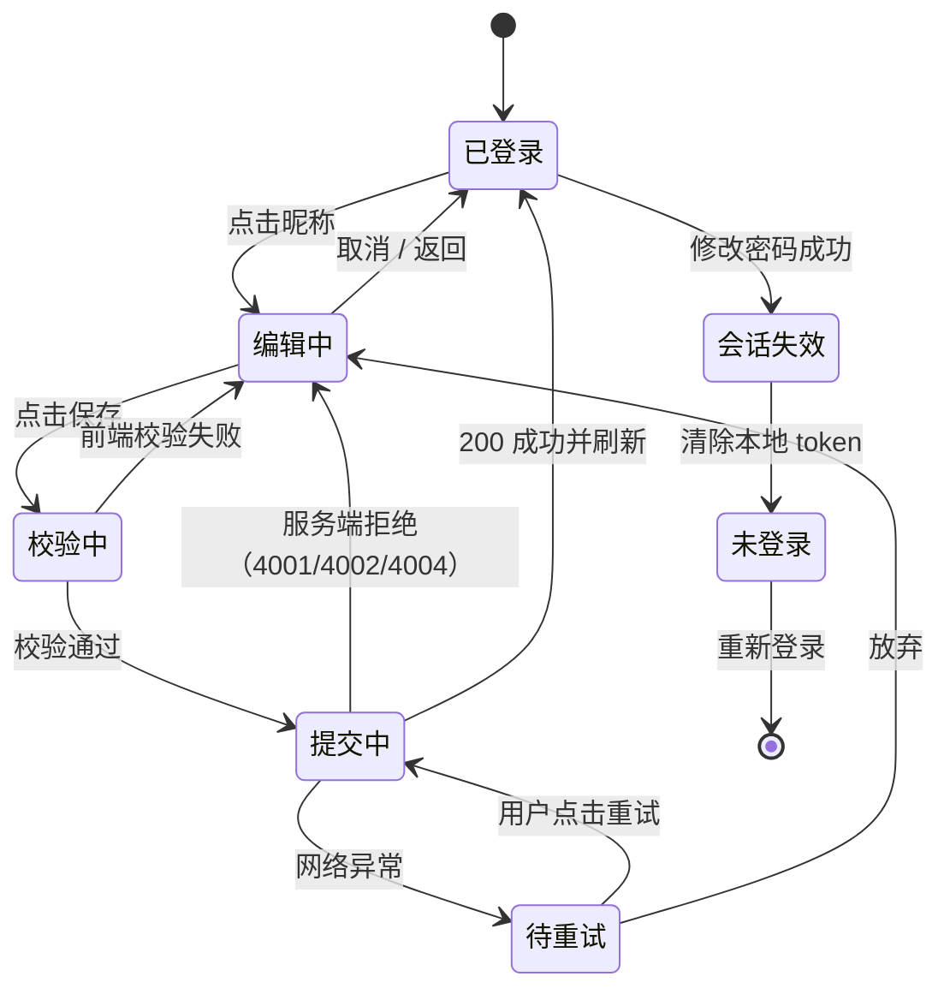

**图注**：`编辑中` 是一个可回退的稳定态——无论前端校验失败、服务端拒绝还是网络异常，都必须能回到它，且用户已填内容不丢失。这是表单类交互的基本要求。

## 1.10 风险与改进建议

| 风险点 | 具体表现 | 建议 |
| --- | --- | --- |
| 敏感词库只在后端 | 用户输入 20 字被拒，但不知道哪个词违规，反复试错 | 前端接一个轻量"违规词提示"接口（或本地词表缓存），输入时即时提示 |
| 昵称修改无冷却提示 | 用户改完才发现"30 天只能改一次"，体验落差 | 在个人资料页昵称行右侧常驻展示"下次可修改时间" |
| 改密后强制全端下线 | 用户在多设备使用时会"被踢"，容易误以为被盗号 | 改为"仅失效其他设备"，并在设置页展示"登录设备管理"列表 |
| 验证码只有短信通道 | 短信通道故障时整条链路阻断 | 增加语音验证码 / 微信服务通知作为备选通道 |
| 无改密安全通知 | 账号被盗后用户无感知 | 改密成功即发通知短信 + 站内消息（本文已纳入步骤 11） |
| 缺少失败次数可视化 | 用户不知道还剩几次机会 | 校验失败时明确返回剩余次数，锁定后给出解锁时间与客服入口 |

---

# 任务二 图书馆管理系统 UML 建模

## 2.1 系统概述与建模约定

**系统名称**：高校图书馆管理系统（Library Management System, LMS）

**系统范围**：面向读者与馆员的图书检索、借阅归还、预约续借、罚款处理、编目典藏、读者与权限管理、统计报表。

**角色**：

| 角色 | 职责 |
| --- | --- |
| 读者（Reader） | 检索、借阅、归还、续借、预约、缴纳罚款、查看借阅历史 |
| 图书馆员（Librarian） | 办理借还、图书编目与典藏、处理预约到馆、收取罚款、补打凭证 |
| 系统管理员（Admin） | 读者与馆员账号管理、借阅规则参数配置、报表导出、系统监控 |

**建模约定**：
1. 所有图围绕同一个业务内核——**「读者借走一本物理副本，到期归还」**，保证各图之间可以互相追溯（详见 2.12 一致性说明）。
2. 类名、属性名用英文，注释与说明用中文，便于后续映射到数据库表。
3. Mermaid 不原生支持的 UML 图类型，采用图元近似并显式标注偏差。

## 2.2 用例图

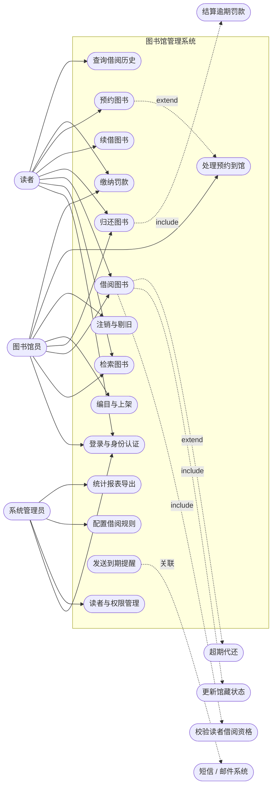

**图注**：

- 因 Mermaid 无原生用例图语法，此图用 flowchart 的圆角端点表示参与者、双圆角框表示用例、虚线箭头表示 `include` / `extend` 关系，**语义为近似表达**。
- `include`（包含）：借阅必然执行"校验借阅资格"与"更新馆藏状态"，属必须行为。
- `extend`（扩展）：只有在特定条件下才发生——"预约到馆处理"仅在预约队列有该书且副本归还时触发；"超期代还"仅在读者超期未还、由他人持委托书代办时触发。
- 严格 UML 版本见附录 A.1。
- 次参与者"短信/邮件系统"以关联方式接入"发送到期提醒"，用于表达系统与外部系统的边界。

## 2.3 类图

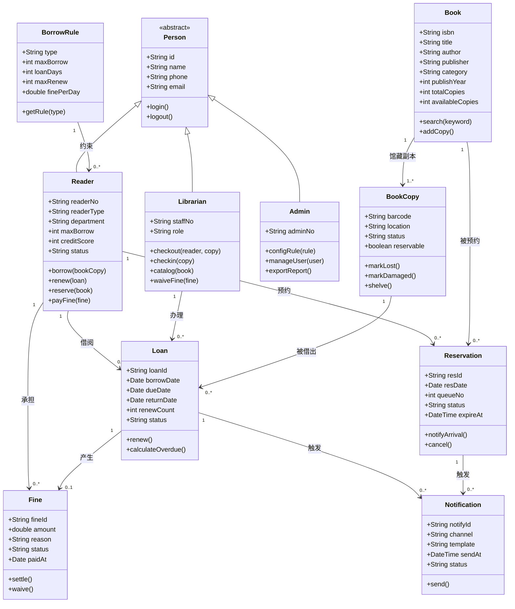

**图注**：

- `Person` 为抽象类，`Reader` / `Librarian` / `Admin` 三类角色泛化继承，共有登录与联系方式属性。
- **Book 与 BookCopy 的拆分是关键设计**：`Book` 是书目（题名、ISBN），`BookCopy` 是具体的物理册（条码、馆藏位置、状态）。读者借走的是"某一本副本"而不是"某本书"，两者是 1 : 1..\*。
- `Loan` 是核心关联类，连接 Reader、BookCopy、Librarian 三方，并可派生 `Fine`。
- 主要多重性：一个读者可有多条借阅（`0..*`），一条借阅最多产生一笔罚款（`0..1`，因为罚款可能合并结算）。

## 2.4 对象图

对象图是类图在某一时刻的**快照**，用于验证类的多重性设计是否成立。

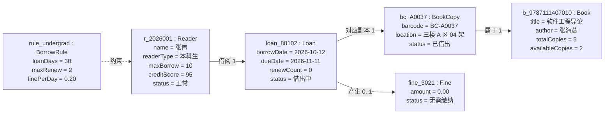

**图注**：

- 每个框的格式为 `对象名 : 类名`，框内为**该时刻的属性取值**，与类图属性一一对应。
- 此快照验证了三条多重性：① 读者 r_2026001 与借阅 loan_88102 是 1 : 0..\*（一个人可有多条借阅，此处只画 1 条）；② Book 与 BookCopy 是 1 : 1..\*（书目有 5 册，此处画 1 册）；③ Loan 与 Fine 是 1 : 0..1（本次借阅尚未逾期，罚款实例处于"无需缴纳"状态）。
- 对象图的作用是"用具体数据检查抽象模型"——如果把 `fine` 挂在 `BookCopy` 上而不是 `Loan` 上，这里立刻就能看出罚款无法追溯到"哪一次借阅"，模型就是错的。

## 2.5 序列图

**场景**：读者到馆，馆员扫描读者证与图书条码办理借阅。

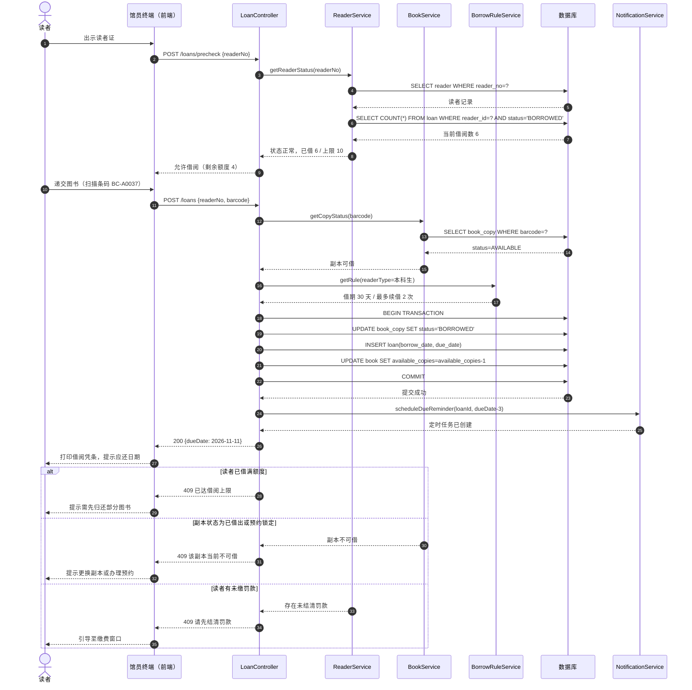

**图注**：

- 前半段是"预检"（读者资格），后半段是"实借"（副本 + 事务落库），这种两段式设计是为了在扫描图书前就拦住不合格读者，避免反复撤销操作。
- 事务内三步必须原子：副本状态 → 借阅记录 → 书目可借数。任何一步失败都要整体回滚，否则会出现"书显示已借出但没有借阅记录"的对账问题。
- `alt` 块列出三种拒绝分支，与活动图的判定节点一一对应。

## 2.6 活动图

**场景**：读者借书业务的完整活动流。这条流程有 18 层纵向节点，直接排在一页里会被压到看不清，因此按**「准入判定」**与**「借出落库」**两段分别绘制——两张图首尾用「阶段交接」节点衔接，合起来仍是一条完整活动流。

### 图 2-5 借阅活动（一）——准入判定

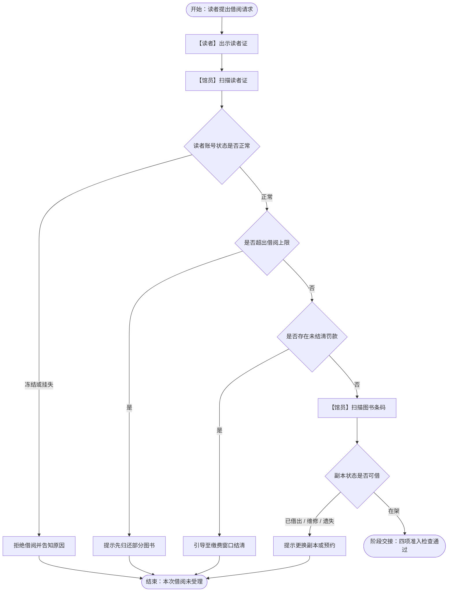

**图注**：四道判定（账号状态 → 借阅上限 → 罚款 → 副本状态）构成借阅业务的**准入漏斗**，顺序不可随意调换：先验人、再验额度、再验欠费、最后验书，能最大程度减少无效扫描。四个异常出口 `X1`–`X4` 都汇入同一个终止节点，因为它们的共同结果是"这次借阅不成立"，区别只在提示语和后续引导。

### 图 2-6 借阅活动（二）——借出落库与完成

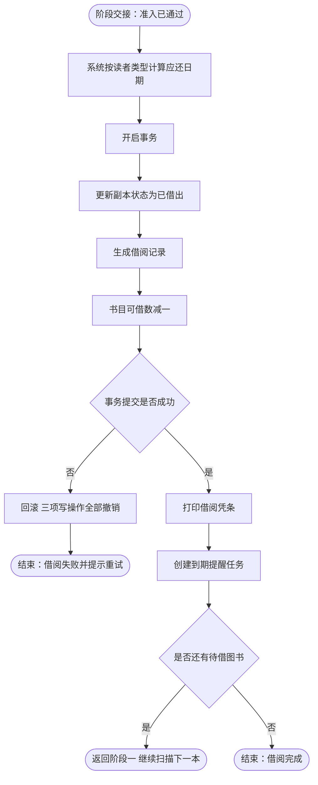

**图注**：事务内的三步写操作（副本状态、借阅记录、书目可借数）必须同生共死，否则会出现"系统显示已借出但没有借阅记录"的对账事故。`J` 的回边对应一次借多本的情形，它回到阶段一的"扫描图书条码"，这就是两张图之间的循环入口——对应 UML 活动图的循环结构，圆角矩形为动作、菱形为判定、`X*` 为异常终止流、双圆为活动终点。

## 2.7 状态图

**对象**：`BookCopy`（馆藏副本）。副本的状态机是整个系统里状态最丰富、最需要严格约束的对象。

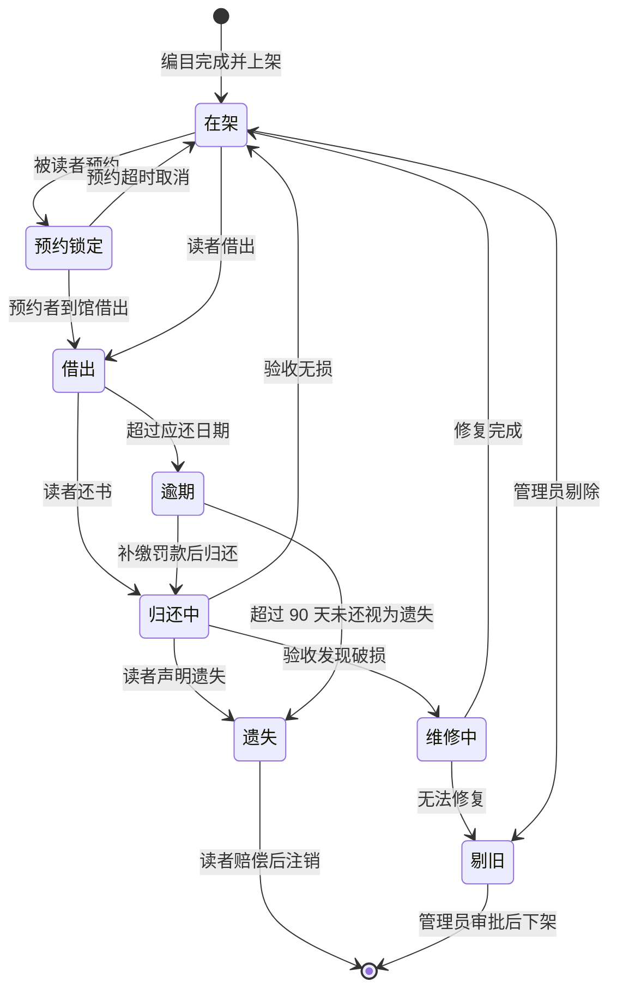

**图注**：

- **守卫条件**：`借出 → 逾期` 由系统定时任务触发（每日 00:05 扫描到期未还记录），不是人为操作；`逾期 → 遗失` 的 90 天阈值来自 `BorrowRule` 配置。
- **不允许的迁移**：`预约锁定 → 逾期`（未借出的副本不可能逾期）、`剔旧 → 借出`（已下架副本不能再借），这两条约束应在服务层硬编码校验。
- 每个状态都对应 `book_copy.status` 字段的一个枚举值，状态图即该字段的合法取值与迁移矩阵。

## 2.8 时序图（Timing Diagram）

时序图关注**对象状态随时间的变化**以及**时间约束**，横轴为时间、纵轴为不同对象的状态轨道。

以下展示同一条借阅生命周期内，`BookCopy` 与 `Loan` 两个对象的状态随时间演进（以 2026-10-12 借出、借期 30 天为例）。

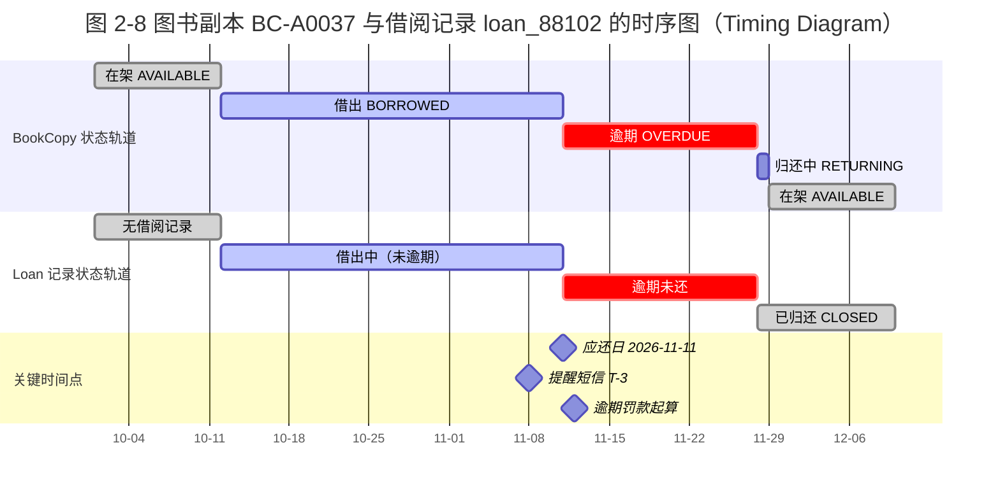

**图注**：

- Mermaid 无原生 Timing Diagram 语法，此处用甘特图的行（section）表示**状态轨道**、色块表示**状态持续区间**、`milestone` 表示**时间约束点**，语义与 UML Timing Diagram 一致，但缺少"状态值纵轴刻度"这一视觉元素。
- 可读出的四条时间约束：① 借期 30 天（10-12 → 11-11）；② 到期前 3 天发提醒（11-08）；③ 逾期次日起计罚（11-12）；④ 逾期 17 天后归还（11-28），产生 `17 × 0.20 = 3.40` 元罚款【按 BorrowRule 中 finePerDay=0.20 计算】。
- 两条轨道的**状态必须联动**：`BookCopy` 从 `借出` 转 `在架` 的那一刻，`Loan` 必须同时从 `逾期` 转 `已归还`，这个原子性由 2.5 序列图中的事务保证。

## 2.9 组件图

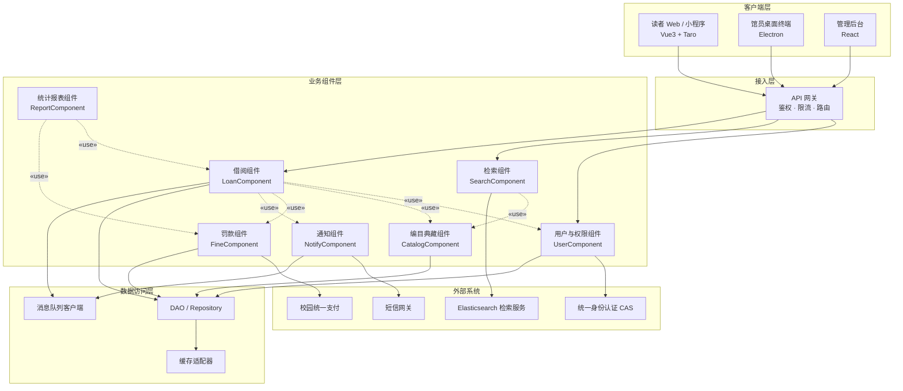

**图注**：

- 用 flowchart 的 `subgraph` 表示分层，矩形节点表示组件，虚线 `«use»` 表示组件间的使用依赖（提供接口 / 需求接口的简化表达）。
- **单向依赖**：业务组件只能向下依赖数据访问层，禁止横向直接调用彼此的内部实现；`LoanComponent` 对 `FineComponent` 的依赖通过接口调用（如 `FineService.calculate()`），这保证了罚款计算规则可独立替换。
- 通知组件走消息队列而非同步调用，是为了让"借阅成功"不被短信通道的延迟或故障拖慢——这是可用性上的关键取舍。

## 2.10 部署图

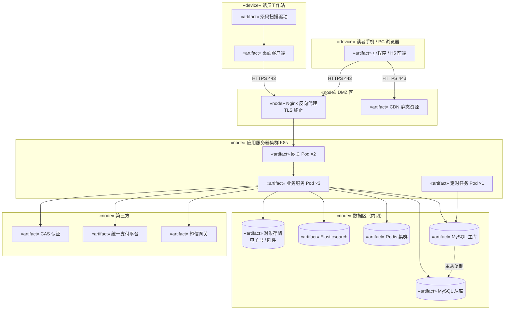

**图注**：

- Mermaid 用 flowchart + `subgraph` 表达部署图：`«device»` 为终端设备节点、`«node»` 为执行环境、`«artifact»` 为部署其上的构件、圆柱图形表示数据存储。
- 三层网络隔离：DMZ（对外）→ 应用区 → 数据区（仅应用区可达，无外网出口），这是部署图最应体现的安全约束。
- **主从分离**：写操作走主库、报表与检索类只读查询走从库，避免大报表拖慢借还业务。
- 定时任务单独部署为 1 个 Pod 并加分布式锁，防止多副本重复发送到期提醒。

## 2.11 Legacy Syntax 图

### 2.11.1 何为 Legacy Syntax

"Legacy syntax"指绘图工具**早期版本沿用的旧语法**。以 Mermaid 为例，目前仍被解析器兼容、但官方已推荐迁移的旧写法主要有：

| 类别 | 旧语法（Legacy） | 新语法（Current） | 说明 |
| --- | --- | --- | --- |
| 图类型声明 | `graph TD` | `flowchart TD` | `graph` 为 8.x 时代的写法，新版本统一为 `flowchart`，且新语法支持更多节点形状 |
| 状态图 | `stateDiagram` | `stateDiagram-v2` | v1 不支持复合状态与 `note`，v2 起重写渲染引擎 |
| 状态迁移标签 | `A --> B : 事件` | 同上，但 v2 支持 `: 事件 / 动作` | v1 不支持动作段 |
| 注释 | `%% 注释`（不变） | `%% 注释` | 仍通用 |
| 序列图便签 | `note left of A` | `Note left of A:` | 旧写法大小写不敏感，仍可解析 |

下面给出与 2.6、2.7 两张图**核心路径一致、但使用旧语法**的版本，用于对照学习。为便于排版比较，旧语法版只保留主干判定，把四道准入检查合并为两条。

### 2.11.2 Legacy 版借阅活动流程（`graph` 旧语法）

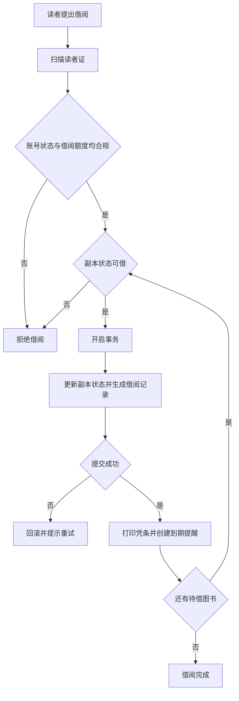

**图注**：`graph` 为 Mermaid 8.x 的图类型标识，10.x 起官方推荐 `flowchart`。二者渲染结果基本一致，但 `flowchart` 支持 `A@{ shape: ... }` 新节点形状语法与更完善的子图定位，新项目不应再使用 `graph`。本节重点是语法对照，因此只保留主干判定；完整的四道准入检查见 2.6 节。

### 2.11.3 Legacy 版图书副本状态图（`stateDiagram` v1 旧语法）

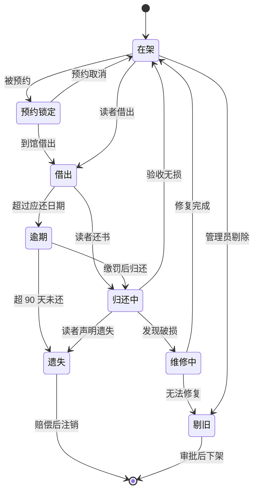

**图注**：`stateDiagram`（v1）与 `stateDiagram-v2` 的差异有三点：① v1 不支持 `state "描述" as 别名` 的别名定义，状态名必须直接可读；② v1 不支持复合状态（嵌套状态机）与 `note`；③ v1 的布局引擎较旧，状态数超过 10 个时连线容易交叉。因此正式文档（2.7 节）使用 v2，本节仅作旧语法对照。

## 2.12 模型一致性说明

同一系统的十张图不是孤立的，它们必须能互相追溯。本文的对应关系如下：

| 追溯维度 | 体现 |
| --- | --- |
| 用例 → 活动 | 用例图 UC-03「借阅图书」的 `include` 关系（校验资格、更新馆藏），在活动图中展开为"借阅上限判定"与"副本状态判定" |
| 用例 → 序列 | UC-03 的完整交互，在序列图中展开为 6 个对象、18 条消息，含 3 条 `alt` 拒绝分支 |
| 类 → 对象 | 对象图的 5 个实例全部是类图中定义的类的实例，属性名与类属性严格一致 |
| 类 → 状态 | 状态图的每个状态都对应 `BookCopy.status` 的枚举值，状态图即该属性的取值约束 |
| 状态 → 时序 | 时序图中 `BookCopy` 与 `Loan` 两条轨道，是状态图两条主链在时间轴上的投影 |
| 组件 → 部署 | 组件图的 7 个业务组件，在部署图中映射为应用服务器上的 Pod（网关 2 个、业务 3 个、定时 1 个） |
| 全链路 | 「读者借走一本副本 → 到期归还」这条主线贯穿用例、活动、序列、状态、时序五张图，任一环节变更都需同步修订 |

**建模自查结论**：十张图在实体命名（Book / BookCopy / Loan / Fine / Reader / BookCopy.status）、角色划分（读者 / 馆员 / 管理员）、时间阈值（借期 30 天、可续借 2 次、逾期 0.20 元/天、逾期 90 天计遗失）三个维度上保持一致，未发现相互矛盾的建模决策。

---

# 附录 A PlantUML 源码

Mermaid 对用例图、时序图、部署图的支持为近似表达。若需严格 UML 语义（或在支持 PlantUML 的环境中渲染），可使用以下源码。

## A.1 用例图（PlantUML 严格版）

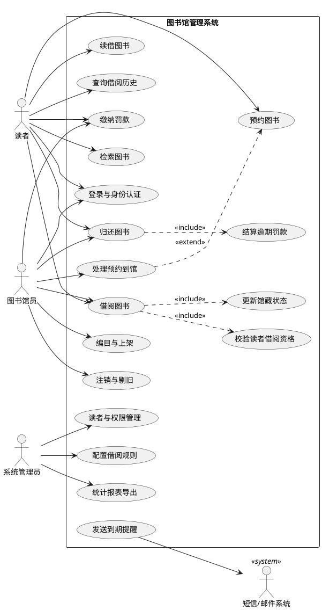

## A.2 序列图（PlantUML 严格版，含激活期与时间约束）

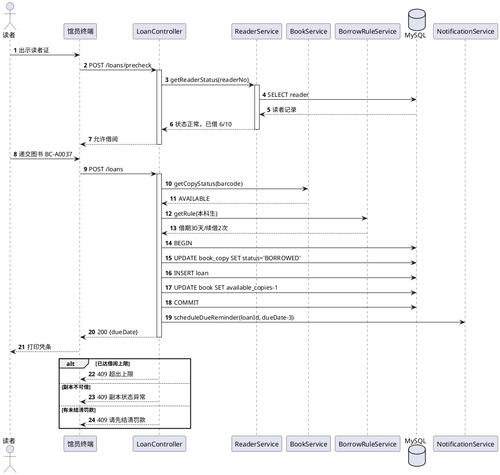

---

# 附录 B 图目录

| 编号 | 图名 | 类型 | 所在章节 |
| --- | --- | --- | --- |
| 图 1-1 | 修改用户名事件流流程图 | 流程图（Mermaid flowchart） | 1.8 |
| 图 1-2 | 修改登录密码（一）：身份核验阶段 | 流程图（Mermaid flowchart） | 1.8 |
| 图 1-3 | 修改登录密码（二）：设置新密码与生效 | 流程图（Mermaid flowchart） | 1.8 |
| 图 1-4 | 修改操作前后端事件交互序列图 | 序列图 | 1.8 |
| 图 1-5 | 修改操作状态迁移图 | 状态图 | 1.9 |
| 图 2-1 | 图书馆管理系统用例图 | 用例图（近似） | 2.2 |
| 图 2-2 | 图书馆管理系统类图 | 类图 | 2.3 |
| 图 2-3 | 借阅场景对象图 | 对象图（近似） | 2.4 |
| 图 2-4 | 办理借阅序列图 | 序列图 | 2.5 |
| 图 2-5 | 借阅活动（一）：准入判定 | 活动图（近似） | 2.6 |
| 图 2-6 | 借阅活动（二）：借出落库与完成 | 活动图（近似） | 2.6 |
| 图 2-7 | 图书副本状态图 | 状态图 | 2.7 |
| 图 2-8 | 副本与借阅记录时序图 | 时序图（甘特近似） | 2.8 |
| 图 2-9 | 系统组件图 | 组件图（近似） | 2.9 |
| 图 2-10 | 系统部署图 | 部署图（近似） | 2.10 |
| 图 2-11 | 借阅活动流程（Legacy `graph` 语法） | 旧语法流程图 | 2.11.2 |
| 图 2-12 | 图书副本状态图（Legacy `stateDiagram` v1） | 旧语法状态图 | 2.11.3 |

**合计**：任务一 5 张图，任务二 12 张图，共 17 张图。

> 说明：图 1-2 / 1-3 与图 2-5 / 2-6 各自由一条长流程拆分而来，目的是让图形在 A4 纸面上保持可读字号；拆分处的「阶段交接」节点即原流程的衔接点，逻辑上仍是同一条事件流 / 活动流。
