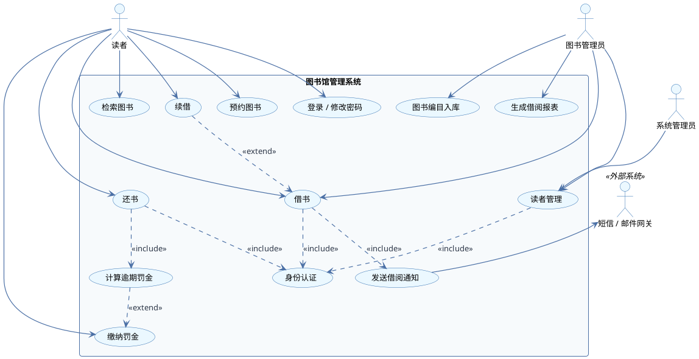
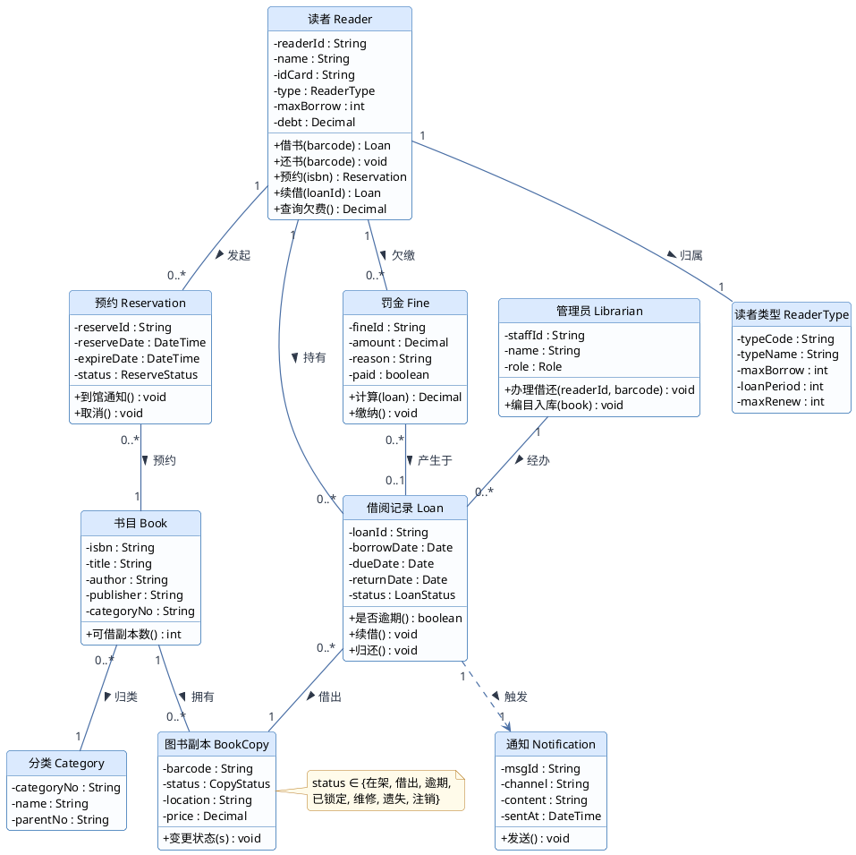
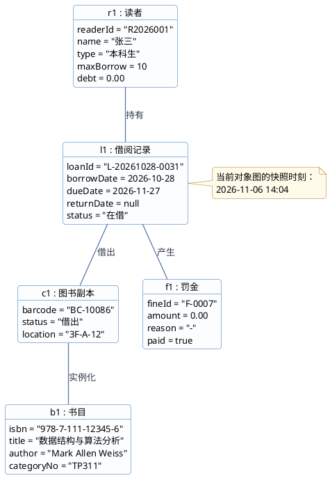
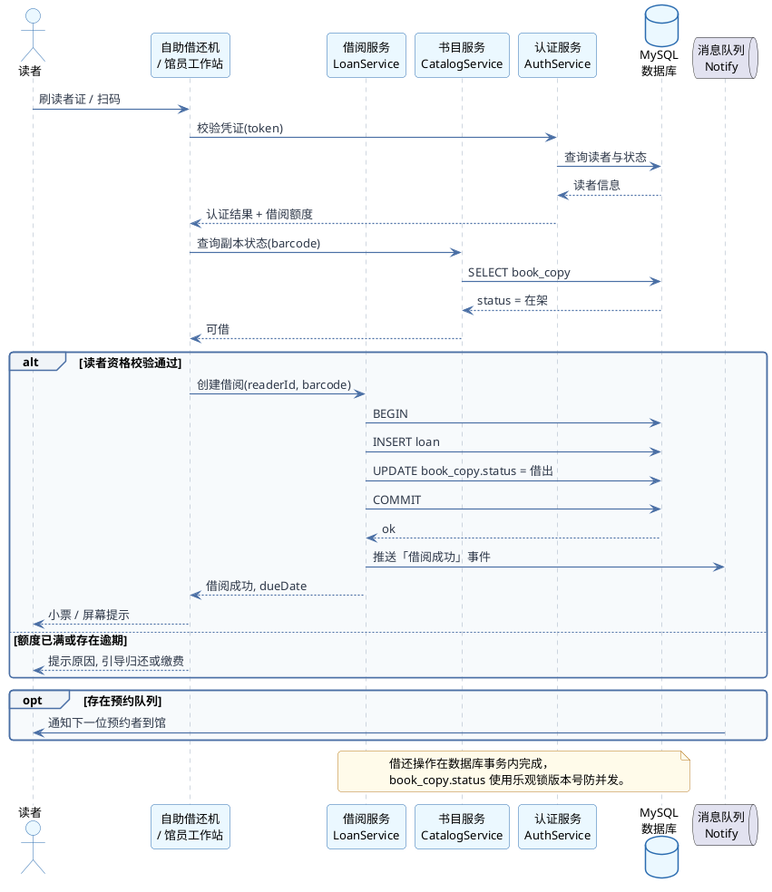
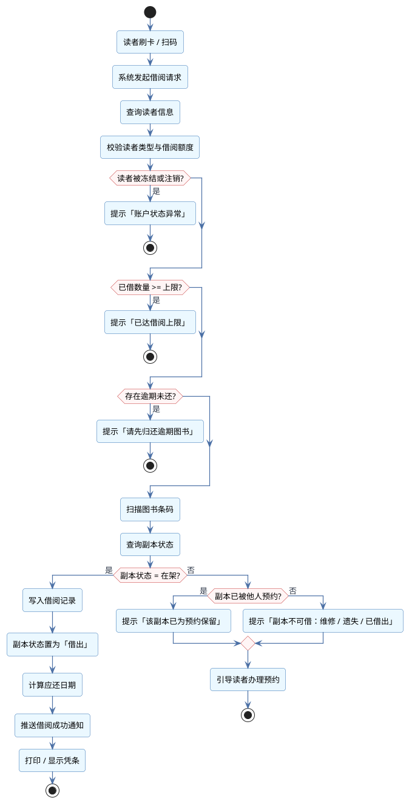
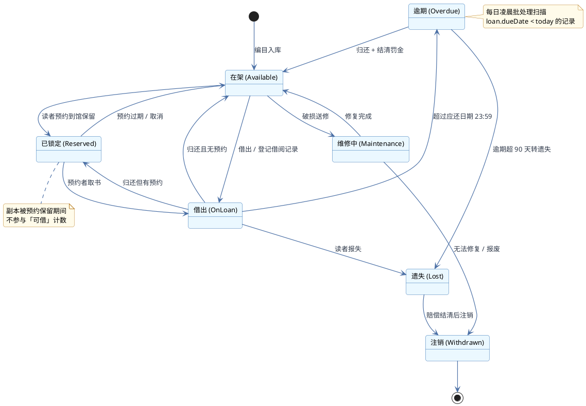
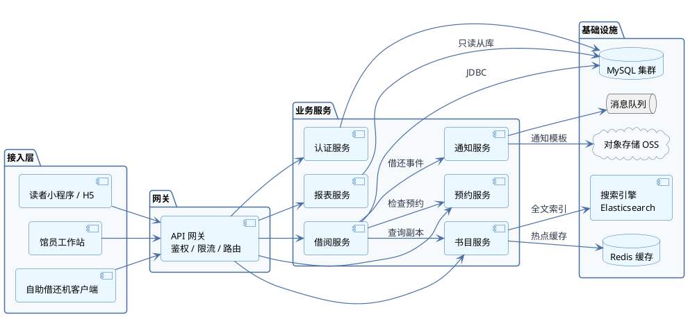
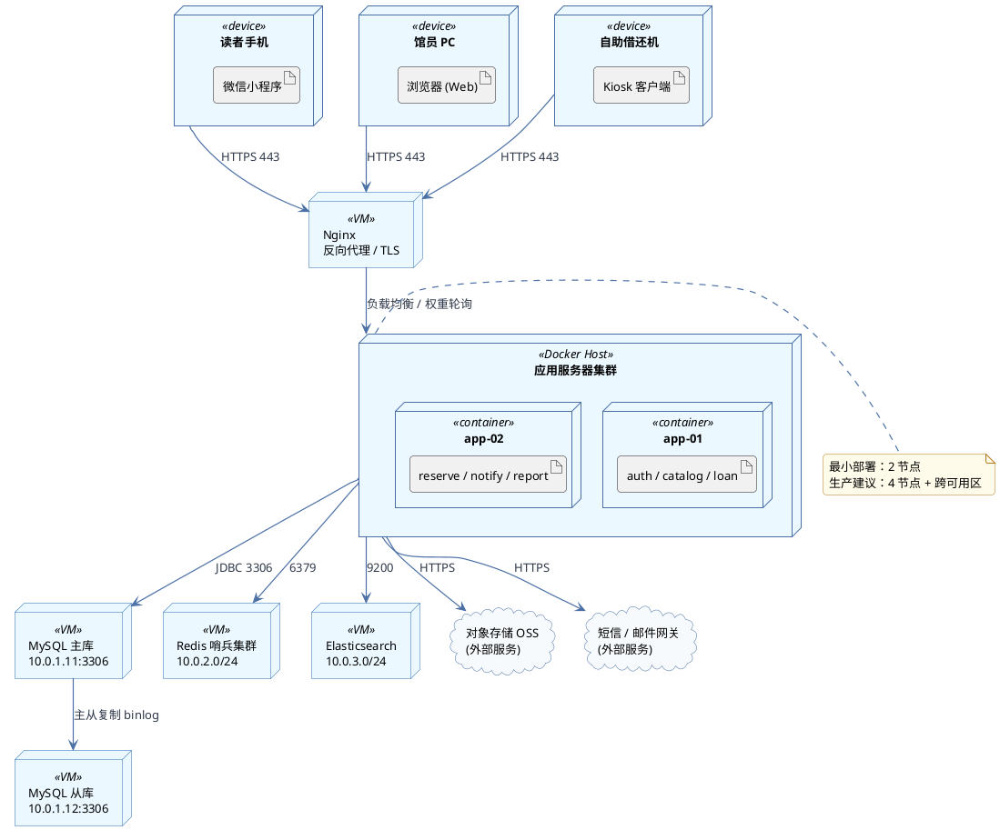
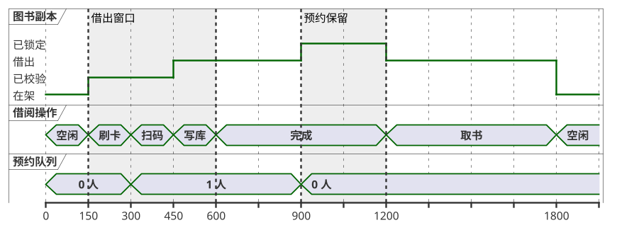
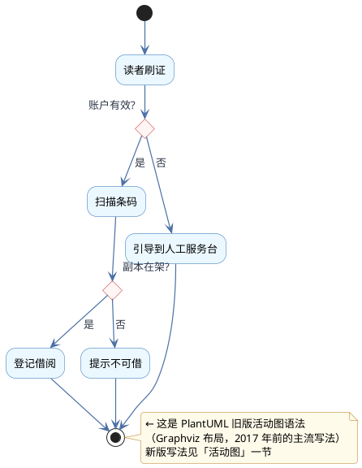

# 图书馆管理系统 · UML 图集

> 《信息系统分析与设计》课程作业 · 2026-11-06

按「需求 → 结构 → 行为 → 实现」的顺序组织 10 类视图：先界定系统边界，再固化静态结构，随后分别用交互、流程、状态刻画动态行为，最后落到组件划分与物理部署。所有图共用同一套领域词汇，可交叉索引。

## 目录

- `01` 用例图 Use Case Diagram
- `02` 类图 Class Diagram
- `03` 对象图 Object Diagram
- `04` 时序图 Sequence Diagram
- `05` 活动图 Activity Diagram
- `06` 状态图 State Diagram
- `07` 组件图 Component Diagram
- `08` 部署图 Deployment Diagram
- `09` 时序图 · 时间轴 Timing Diagram
- `10` Legacy syntax 旧版语法

---

## 01 用例图

*Use Case Diagram*

描述系统对外提供的功能边界与三类角色的关系。读者侧覆盖检索、借还、续借、预约与缴费；馆员侧覆盖编目入库与读者管理。`«include»` 表示必经的公共子流程（身份认证、通知发送），`«extend»` 表示条件触发的可选扩展（续借、罚金缴纳）。

PlantUML 源码（点击展开，可直接复制修改）

---

## 02 类图

*Class Diagram*

核心领域模型。关键设计：**书目 Book 与图书副本 BookCopy 分离**——同一 ISBN 可有多册实体副本，借阅必须绑定到具体副本的条码，这是图书馆业务区别于普通电商库存的核心特征。借阅记录 Loan 承担读者与副本之间的多对多关联，并沉淀罚金 Fine。

PlantUML 源码（点击展开，可直接复制修改）

---

## 03 对象图

*Object Diagram*

类图在某一时刻的实例快照，用于验证模型能否承载真实数据。这里取 2026-11-06 14:04 的运行时状态：读者张三持有一条在借记录，对应副本 BC-10086。对象图常用于和业务方对齐字段与取值，也便于为单元测试准备夹具数据。

PlantUML 源码（点击展开，可直接复制修改）

---

## 04 时序图

*Sequence Diagram*

借书场景的交互顺序。要点：**认证前置**（额度校验先于库存校验）、**事务边界**（写借阅记录与改副本状态在同一事务内）、**alt/opt** 分别表达资格校验的双分支与预约队列的可选后续。

PlantUML 源码（点击展开，可直接复制修改）

---

## 05 活动图

*Activity Diagram*

借书流程的控制流与判定节点。三道前置闸门（账户状态、借阅额度、逾期欠费）依次过滤，任何一个不通过即终止流程并给出可操作提示；只有副本处于「在架」且未为他人保留时才允许出借。

PlantUML 源码（点击展开，可直接复制修改）

---

## 06 状态图

*State Diagram*

图书副本的生命周期。状态机的价值在于把「谁能在什么条件下把状态改成什么」这一规则集中约束，避免出现已注销副本仍可借出的脏数据。**在架 ⇄ 借出 ⇄ 逾期** 是主循环，维修、遗失、注销是三条终局或旁路分支。

PlantUML 源码（点击展开，可直接复制修改）

---

## 07 组件图

*Component Diagram*

按业务能力拆分的服务组件与依赖关系。接入层统一走 REST 网关；借阅服务依赖书目与预约服务做校验，通过消息队列解耦通知。缓存与搜索引擎分别承担热点书目和全文检索，报表服务读从库以免拖慢交易链路。

PlantUML 源码（点击展开，可直接复制修改）

---

## 08 部署图

*Deployment Diagram*

运行时的物理/虚拟节点拓扑。客户端 → Nginx → 无状态应用容器集群 → MySQL 主从 + Redis + ES + 外部 OSS/短信网关。应用层无状态化是水平扩容的前提；主从复制承担读扩展与容灾。

PlantUML 源码（点击展开，可直接复制修改）

---

## 09 时序图 · 时间轴

*Timing Diagram*

以时间轴横向展开的状态变化视图，比普通时序图更适合表达「某对象在某时间段处于什么状态」。这里同时呈现副本状态、操作步骤与预约排队人数三者的并发演进，并用高亮标出「借出窗口」与「预约保留」两段关键区间。

PlantUML 源码（点击展开，可直接复制修改）

---

## 10 Legacy syntax

*旧版语法*

严格说它不是一种独立的图类型，而是 PlantUML 官方文档导航中的「遗留语法」入口——指 2017 年新版活动图语法（`start/stop/if`）普及之前、基于 Graphviz 的旧写法。`(*)` 表示起点/终点，箭头上的 `[条件]` 表示分支。维护老项目文档时仍会遇到，故一并列出对照。

PlantUML 源码（点击展开，可直接复制修改）

---

## 建模约定

- **书目 Book 与图书副本 BookCopy 分离**：同一 ISBN 可有多册实体副本，借阅必须绑定到具体副本的条码。
- **状态机与枚举对齐**：状态图的状态集合与类图中 `CopyStatus` 枚举保持一致。
- **变更顺序**：若业务规则调整，先改类图与状态图，再同步时序图与活动图。

## 附：图与源码对应关系

| 编号 | 视图 | 源码文件 | 图片文件 |
|---|---|---|---|
| 01 | 用例图 | `src/01-usecase.puml` | `md-assets/01-usecase.png` |
| 02 | 类图 | `src/02-class.puml` | `md-assets/02-class.png` |
| 03 | 对象图 | `src/03-object.puml` | `md-assets/03-object.png` |
| 04 | 时序图 | `src/04-sequence.puml` | `md-assets/04-sequence.png` |
| 05 | 活动图 | `src/05-activity.puml` | `md-assets/05-activity.png` |
| 06 | 状态图 | `src/06-state.puml` | `md-assets/06-state.png` |
| 07 | 组件图 | `src/07-component.puml` | `md-assets/07-component.png` |
| 08 | 部署图 | `src/08-deployment.puml` | `md-assets/08-deployment.png` |
| 09 | 时序图 · 时间轴 | `src/09-timing.puml` | `md-assets/09-timing.png` |
| 10 | Legacy syntax | `src/10-legacy.puml` | `md-assets/10-legacy.png` |
