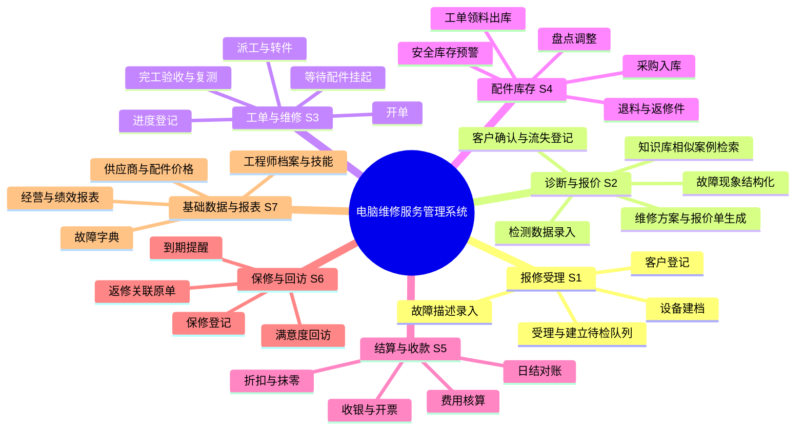
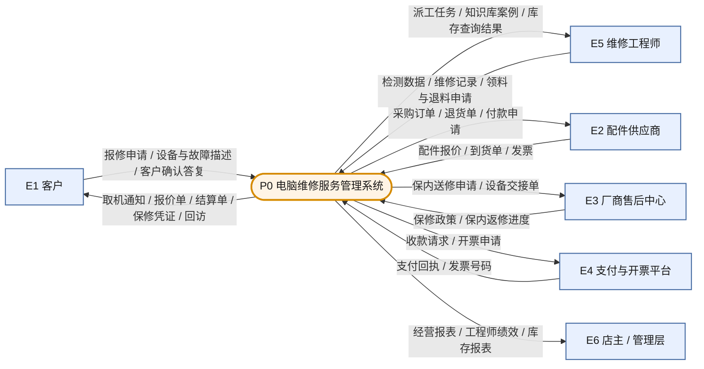
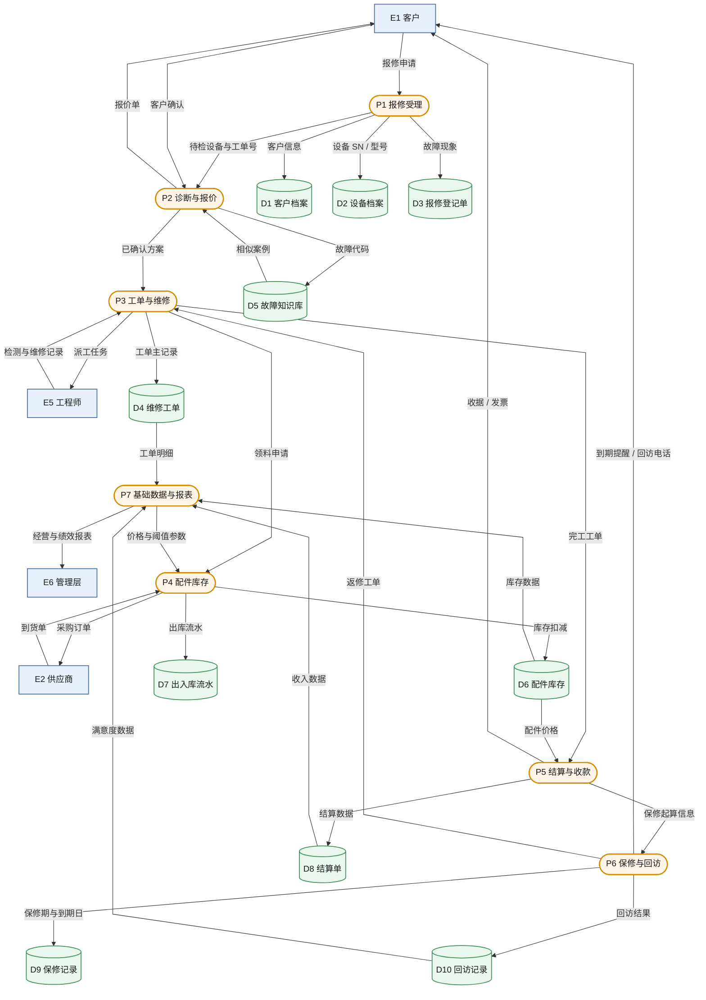
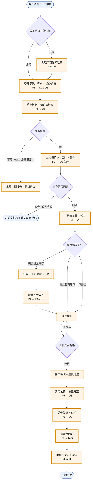

# 电脑维修服务管理系统 · 数据流分析报告

> 分析方法：结构化分析方法（SA），以数据流图（DFD）为核心工具，自顶向下逐层分解。
> 文档载体：Markdown；图形语法：Mermaid（可用 VS Code / Typora / mermaid.live 直接渲染）。

---

## 0. 系统概述与分析约定

### 0.1 系统定位

本系统服务于一家电脑维修门店（含 1～5 家连锁门店场景），覆盖 **"客户送修 → 检测诊断 → 报价确认 → 维修作业 → 结算收款 → 保修回访"** 的完整业务闭环，同时管理配件库存、工程师排班、故障知识沉淀与经营数据。

### 0.2 编号与图例约定

| 图元 | 含义 | 编号规则 | 示例 |
|---|---|---|---|
| 矩形 | 外部实体（人/外部系统，系统边界之外） | E + 序号 | E1 客户 |
| 圆角矩形 | 处理（数据加工） | P + 层号 + 序号 | P2 诊断与报价 |
| 圆柱 | 数据存储（需长期保存的数据） | D + 序号 | D4 维修工单 |
| 箭头 | 数据流（必须是"名词"，不能是"动作"） | F + 序号 | F12 报价单 |

**分解层次**：顶层图（1 个处理）→ 0 层图（7 个子系统）→ 功能分解树（3 级）→ 功能点（可编程实现级）。

---

## 1. 思维导图（系统功能分解）



---

## 2. 流程图

### 2.1 顶层数据流图（Context Diagram，L0）

只画系统与外部环境的边界，体现"系统是一个黑盒"。



### 2.2 0 层数据流图（第一层分解，7 个子系统）

子系统之间**不直接调用**，而是通过数据存储与显式数据流耦合——这是判断"相对独立"的关键设计。



### 2.3 核心业务流程（报修 → 回访全链路）



---

## 3. 调用的工具清单

### 3.1 绘图与文档工具链

| 序号 | 环节 | 调用的工具 / 语法 | 具体作用 | 备注 |
|---|---|---|---|---|
| 1 | 分析对象确认 | 交互式选项提问 | 锁定系统边界与业务范围，避免建错模型 | 本轮已确定为"电脑维修服务管理系统" |
| 2 | 功能结构梳理 | **Mermaid `mindmap`** 语法 | 生成三级功能分解思维导图（第 1 节） | 需 Mermaid ≥ 9.3 |
| 3 | 数据流建模 | **Mermaid `flowchart LR / TB`** | 绘制顶层图、0 层 DFD、业务流程图 | 用 `-->` 带标签边表示数据流 |
| 4 | 图元区分 | **Mermaid `classDef` + `class`** | 用不同填充色区分"实体 / 处理 / 数据存储" | 对应 DFD 四种标准图元 |
| 5 | 节点形状语义 | `["矩形"]`、`(["圆角"])`、`[("圆柱")]` | 矩形=外部实体，圆角=处理，圆柱=数据存储 | 与国标 DFD 图元一一对应 |
| 6 | 文档载体 | **Markdown（.md）** | 全文单一源文件，纯文本可做 Git 版本管理 | 本报告即为 .md |
| 7 | 图形渲染 | VS Code + *Markdown Preview Mermaid Support* 插件 / Typora / mermaid.live / GitHub | 把代码块渲染成可视图形 | 不装插件时只显示代码块 |
| 8 | 导出成图 | 渲染界面「导出 PNG / SVG」 | 贴进 Word、PPT 或论文 | SVG 放大不失真，优先 |
| 9 | 文件产出 | 本地文件写入 | 生成并保存本 .md 文件 | 路径见文末 |

### 3.2 使用提示

- 若在**不支持 Mermaid 的编辑器**（如记事本、旧版 Word）中打开，图形会显示为代码块，需先渲染再截图。
- `mindmap` 依赖缩进表达层级，**修改层级时必须保持缩进对齐**，否则渲染报错。
- 流程图节点文字中若含英文括号、冒号，务必用双引号包裹，例如 `A["故障（主板级）"]`。

---

## 4. 七个问题的回答

### 问题 1：系统作为信息处理器主要完成什么功能？最重要的输入与输出数据是什么？

**一句话概括**：把客户口中"电脑开不了机、老是蓝屏"这类**模糊、非结构化的自然语言描述**，逐级加工为**可执行的维修方案、可结算的收费凭证、可复用的故障案例**三类结构化信息。

**信息加工链（这是本系统的本质）**：

```
故障现象（自然语言）
   → 故障代码（结构化，对照故障字典）
   → 检测数据（量化：电压/温度/SMART/跑分）
   → 诊断结论（因果判断）
   → 维修方案 + 报价（决策）
   → 工单执行记录（事实）
   → 结算金额（价值量化）
   → 保修承诺与回访评分（承诺与反馈）
   → 知识库案例（经验固化）
```

**最重要的输入数据（按重要性排序）**：

| 排序 | 输入数据 | 来源 | 为什么最重要 |
|---|---|---|---|
| 1 | 报修信息：客户身份 + 设备品牌型号/SN + 故障现象 | E1 客户 | 一切业务的起点；SN 是串起全生命周期的唯一主键 |
| 2 | 检测数据：诊断结论、检测项读数 | E5 工程师 | 决定"修不修、怎么修、收多少"，是系统最核心的加工输入 |
| 3 | 配件价格与库存数据 | E2 供应商 / D6 | 直接决定报价准确性与毛利 |
| 4 | 保修政策数据 | E3 厂商 | 决定"是否收费"这个二元判断，错判会导致直接亏损 |

**最重要的输出数据（按重要性排序）**：

| 排序 | 输出数据 | 去向 | 为什么最重要 |
|---|---|---|---|
| 1 | **维修工单**（诊断结论+维修措施+更换配件+工程师+工时） | D4 / 客户 / 管理层 | **全系统的主数据**。它是唯一能串起"报修→诊断→维修→结算→保修→回访"的实体，缺它则数据流断裂 |
| 2 | **结算单**（工时费+配件费+优惠+实收+支付方式） | E1 客户 / D8 | 系统的价值兑现点，也是财务与税务的唯一凭据 |
| 3 | 保修凭证与到期日 | E1 / D9 | 承诺的书面化，是后续回访与二次销售的触发源 |
| 4 | 经营与绩效报表 | E6 管理层 | 系统对经营的反馈，决定采购与人员决策 |

> **判断依据**：如果只能保留一张表，必须保留维修工单——其余数据（客户、设备、库存、保修）都可以围绕工单反推重建；反之则不可逆。

---

### 问题 2：系统作为一个整体，与外界环境存在什么关系？

**（1）系统边界**

- **边界之内**：报修受理、诊断报价、工单维修、配件库存、结算收款、保修回访、基础数据与报表。
- **边界之外**：客户、维修工程师（作为"人"的角色）、配件供应商、厂商售后中心、支付与开票平台、店主/管理层、平台评价体系（美团/大众点评）。

**（2）六类外部实体及其数据交换**

| 实体 | 向系统输入 | 从系统接收 | 关系性质 |
|---|---|---|---|
| E1 客户 | 报修申请、故障描述、确认答复、付款 | 报价单、取机通知、结算单、保修凭证、回访 | **强交互、高频**，系统的"需求源"与"验收方" |
| E2 供应商 | 配件报价、到货单、发票 | 采购订单、退货单、付款申请 | 供应链上游，价格波动直接传导到报价 |
| E3 厂商售后 | 保修政策、返修进度 | 保内送修申请、设备交接单 | 低频但**高风险**：政策误判=直接亏损 |
| E4 支付/开票 | 支付回执、发票号 | 收款请求、开票申请 | 只做金额与凭证交换，不参与业务逻辑 |
| E5 工程师 | 检测数据、维修记录、领料/退料 | 派工任务、案例推荐、库存查询 | **人在环中（HITL）**，是数据质量的关键控制点 |
| E6 管理层 | 目标值与权限设定 | 经营报表、绩效、库存报表 | 单向监督关系，只读不写业务数据 |

**（3）环境的不可控性 → 系统必须内置"缓冲层"**

| 不可控因素 | 对系统的冲击 | 系统的应对设计 |
|---|---|---|
| 配件价格随行情波动 | 报价失效、毛利被侵蚀 | P7 维护价格参数表 + 报价单有效期（如 7 天） |
| 厂商保修政策变更 | 收费判断错误 | D9 保修政策版本号 + 生效日期，按工单日期取版本 |
| 客户到店量峰谷（开学季、雨季） | 工程师排班失衡 | 待检队列 + 派工负载阈值 |
| 平台差评 | 影响获客 | 满意度回访数据回流至绩效评估 |

**（4）系统对环境的反作用**

- 库存低于安全阈值 → 自动向 E2 发出采购申请（**主动影响供应链**）；
- 保修到期前 30 天 → 主动触达客户（**创造二次销售机会**）；
- 月度报表 → 影响管理层的人员与备货决策（**反馈闭环**）。

> 结论：本系统不是被动记录工具，而是**"接收模糊需求 → 输出标准化承诺"的转换器**；它对环境高度依赖（价格、政策、客流均不可控），因此必须通过参数化设计把"不可控"隔离在基础数据层，避免直接侵入业务逻辑。

---

### 问题 3：能否分解为几个相对独立又有联系的子系统？

**能，可分解为 7 个子系统。** 判据是"高内聚、低耦合"——每个子系统**独占**自己的数据存储，其他子系统只能读、不能写。

| 子系统 | 独占数据存储（只写） | 对外提供的服务 | 依赖的其他子系统 |
|---|---|---|---|
| S1 报修受理 | D1 客户档案、D2 设备档案、D3 报修登记单 | 建档、去重、生成待检队列 | 无（**最上游，零依赖**） |
| S2 诊断与报价 | 检测记录（附属 D4）、报价单 | 结构化故障、生成报价、记录客户确认 | S1（取客户与设备信息）、D5 |
| S3 工单与维修 | D4 维修工单 | 开单、派工、状态机流转、完工 | S2（取已确认方案）、S4（领料） |
| S4 配件库存 | D6 库存、D7 流水 | 入库、出库、退料、盘点、预警 | 仅读 D4 的领料申请（**耦合最低**） |
| S5 结算与收款 | D8 结算单、支付流水 | 核算、收银、开票、日结 | S3（取完工工单）、D6（取价） |
| S6 保修与回访 | D9 保修记录、D10 回访记录 | 保修起算、到期提醒、回访、返修关联 | S5（取完工与金额） |
| S7 基础数据与报表 | 工程师/供应商/故障字典/价格表 | 参数维护、多维报表 | **只读全库，不回写业务数据** |

**独立性证据（三条硬指标）**：

1. **数据所有权唯一**：每张表只有一个子系统有写权限，杜绝"多处更新导致不一致"。
2. **可替换性**：S4 配件库存可以整体替换为第三方进销存（甚至 ERP 模块），只要保证出库/入库接口不变，其余 6 个子系统无需改动——这是最有力的低耦合验证。
3. **故障隔离**：S7 报表服务宕机，不影响开单收款；S2 报价模块升级，不影响已开出的工单继续流转。

**联系（耦合方式）**：通过**共享数据存储 + 显式数据流**联系，而非直接函数调用。典型的三条强联系：
- `S2 → S3`：只有"客户确认后的方案"才能开单（**业务闸门**）；
- `S3 → S4`：领料申请是唯一允许触碰库存的入口（**防越权**）；
- `S5 → S6`：结算完成才起算保修（**承诺有前提**）。

---

### 问题 4：分解后的子功能是否仍很复杂？能否继续细分？

**能。** 第一次分解后的 S2、S3、S4 仍有 5 个以上内部步骤，必须继续细分。下方为三级功能分解，带 ★ 的是最复杂、必须再拆到"功能点级"的模块。

| 子系统 | 二级功能 | 三级功能点（可编程实现级） |
|---|---|---|
| S1 报修受理 | 客户登记 | 手机号查重 → 老客户带出 → 新客户建档 |
| | 设备建档 | 品牌型号检索 → SN 录入与校验 → 购机日期/是否在保推定 |
| | 故障描述录入 | 现象模板勾选（不开机/蓝屏/异响/过热/进液）+ 自由文本 + 现场照片 |
| S2 诊断与报价 ★ | 现象结构化 | 自由文本 → 故障字典映射 → 生成故障代码（一对多，如"蓝屏"可映射到 0x7B/0x50/内存/硬盘 4 个候选） |
| | 知识库检索 | 按机型+故障代码召回相似案例 → 按成功率/工时排序展示 |
| | 检测数据录入 | 检测项模板（电压/温度/SMART/内存诊断/跑分）→ 逐项录入 → 自动判合格区间 |
| | 报价生成 | 工时费（按故障等级）+ 配件费（按 BOM）+ 风险附加（如主板级+20%）→ 生成报价单，含有效期 |
| | 客户确认 | 同意/放弃/议价三态 → 放弃须填流失原因（价格/不值得修/待考虑）→ 议价走审批 |
| S3 工单与维修 ★ | 开单 | 校验方案已确认 → 生成工单号 → 锁定报价快照（后续改价不影响已开单） |
| | 派工 | 按技能标签（主板/屏/数据恢复）+ 当前工单数 + 在岗状态评分匹配 |
| | 进度登记 | 状态机：待检→已检→待件→维修中→待验收→已完工；每次流转记时间戳与操作人 |
| | 挂起/转件 | 缺件挂起（关联采购单号）+ 超时预警；转件须填技术原因，转出人留痕 |
| | 完工验收 | 复测项逐项打勾 → 清洁 → 拍照留证 → 生成完工报告（**不合格禁止流转**） |
| S4 配件库存 ★ | 采购入库 | 按采购单收货 → 校验型号/数量/批次 → 入库并回写采购单状态 |
| | 领料出库 | 按工单 BOM 领料 → 校验库存 → 扣减 → 流水记账 → 计入工单成本 |
| | 退料/返修件 | 未用退回（回增库存）/ 故障件退回（进"待返厂"库，**不直接回可用库存**） |
| | 盘点调整 | 冻结 → 实盘录入 → 生成盘盈盘亏单 → 审批后调整 |
| | 预警与采购 | 安全库存/近 30 天日均消耗 → 建议采购量 → 生成采购申请 |
| S5 结算与收款 | 费用核算 / 折扣 / 收银开票 / 日结对账 | 见问题 5 表格，每项为独立功能点 |
| S6 保修与回访 | 保修登记 / 到期提醒 / 回访 / 返修关联 | 返修必须关联原工单号，用于计算返修率 |
| S7 基础数据与报表 | 四类参数维护 + 五张报表 | 参数表均带生效日期，支持"改价不改历史" |

**细分终止判据（何时停止分解）**：

1. **单一动词原则**：一个功能点只对应一个业务动词（录入、计算、校验、打印、查询），不出现"和"字；
2. **可实现原则**：一个功能点能被一个界面 + 一段程序在一个迭代内实现；
3. **单责任人原则**：一个功能点只有一个岗位对其数据负责。

> 注意：细分不是越细越好。**只对"变化频繁"和"逻辑复杂"的部分深挖**（S2 报价、S4 库存），而 S5 收银这类规则稳定的模块保持粗粒度即可，否则维护成本会反噬。

---

### 问题 5：每个功能/子功能的输入数据与输出数据是什么？

| 子系统 | 功能点 | 输入数据（来源） | 输出数据（去向） |
|---|---|---|---|
| S1 | 客户登记 | 姓名、手机号、地址（客户口述/身份证） | 客户档案 D1（新增或更新）、客户号 |
| S1 | 设备建档 | 品牌型号、SN、购机日期、外观照片（客户提供 + 实物核对） | 设备档案 D2（以 SN 为唯一键） |
| S1 | 故障描述录入 | 故障现象、发生时间、是否摔碰/进液（客户口述） | 报修登记单 D3 |
| S1 | 受理建立队列 | D3 + 工程师在岗状态 | 待检队列条目（→ P2）、受理回执（→ 客户） |
| S2 | 现象结构化 | 故障现象文本、机型 | 故障代码（对照故障字典 D5） |
| S2 | 知识库检索 | 故障代码 + 机型 | 相似案例列表及成功率（D5 → 屏幕） |
| S2 | 检测数据录入 | 检测项读数：电压/温度/SMART/内存诊断/跑分 | 检测记录（挂接 D4 工单，作为诊断证据） |
| S2 | 报价生成 | 检测结论 + 配件价格 D6 + 工时单价表 + 风险系数 | 报价单（含有效期 → 客户） |
| S2 | 客户确认 | 客户答复（同意/放弃/议价） | 确认状态（→ P3 开单；放弃则写入流失原因） |
| S3 | 开单 | 已确认方案 + D1/D2 快照 | 维修工单 D4（工单号 + 报价快照） |
| S3 | 派工 | D4 + 工程师技能标签 + 当前负载 | 派工任务（→ E5 工程师） |
| S3 | 进度登记 | 工程师节点回报（已拆机/待件/已修复） | 工单状态更新 D4（含时间戳与操作人） |
| S3 | 挂起/转件 | 缺件说明或转件技术原因 | 挂起状态 + 关联采购单号 / 转件留痕记录 |
| S3 | 完工验收 | 维修记录 + 复测数据 + 整机照片 | 完工工单（→ P5 结算；→ 知识库沉淀） |
| S4 | 采购入库 | 到货单、发票、实收数量（E2 供应商） | 库存增加 D6 + 入库流水 D7 |
| S4 | 领料出库 | 工单领料申请（BOM：配件编码 + 数量） | 库存扣减 D6 + 出库流水 D7 + 工单成本 |
| S4 | 退料/返修件 | 未使用配件 / 故障旧件（工程师退回） | 库存回增（可用库）或转入"待返厂"库 + 退料流水 |
| S4 | 盘点调整 | 实盘数量、盘点差异说明 | 盘盈盘亏单（经审批后调整 D6） |
| S4 | 预警与采购 | 安全库存阈值 + 近 30 天日均消耗 | 采购申请 / 采购订单（→ E2 供应商） |
| S5 | 费用核算 | 完工工单（工时 + 配件 BOM）+ 价格表快照 | 应收金额（工时费 + 配件费 + 附加费） |
| S5 | 折扣与抹零 | 折扣权限、客户等级、实收金额 | 实收金额 + 优惠明细（须留审批痕迹） |
| S5 | 收银开票 | 实收金额 + 支付方式（现金/微信/支付宝/刷卡） | 结算单 D8 + 发票号 + 支付流水（→ E4） |
| S5 | 日结对账 | D8 结算单 + 各支付平台流水 | 日结报表 + 差异单（差异须人工说明） |
| S6 | 保修登记 | 完工日期 + 保修政策（配件/工时分别计） | 保修记录 D9（到期日 = 完工日 + 保修期） |
| S6 | 到期提醒 | D9 保修记录 + 当前日期（每日批处理） | 提醒任务清单（→ 客服，触发延保/保养营销） |
| S6 | 满意度回访 | 完工工单 + 联系方式 + 回访话术模板 | 回访记录 D10 + 满意度评分 + 问题标签 |
| S6 | 返修处理 | 客户返修申请 + 原工单号 | 关联原单的返修工单（→ P3，标记"返修"免工时费） |
| S7 | 基础数据维护 | 工程师档案、供应商、故障字典、价格与阈值 | 各参数表（均带生效日期，改价不改历史） |
| S7 | 报表生成 | D4/D6/D8/D10 只读汇总 | 经营报表（收入/毛利/工单量）、工程师绩效、库存周转、返修率、客户满意度 |

---

### 问题 6：系统中需要长期保存的数据有哪些？如何创建、修改和使用？

**（1）数据存储清单（12 张核心表）**

| 编号 | 名称 | 主要内容 | 创建者与时机 | 修改规则 | 主要使用场景 | 保存期限 |
|---|---|---|---|---|---|---|
| D1 | 客户档案 | 客户号、姓名、手机、地址、客户等级、累计消费 | S1，首次报修时 | 可改联系方式；客户号不可改 | 报修检索、回访、老客识别 | 长期（≥10 年） |
| D2 | 设备档案 | SN、品牌型号、配置、购机日期、维修历史 | S1，首次接修该设备时 | 配置可补录；SN 不可改（主键） | 判断在保、查历史故障、同机复发分析 | 长期 |
| D3 | 报修登记单 | 报修号、故障描述、送修方式、受理人 | S1，客户到店时 | 未受理前可改；受理后锁定 | 排队管理、日接待量统计 | 未成交 90 天后归档 |
| D4 | **维修工单** | 工单号、诊断结论、维修措施、更换配件、工程师、工时、状态机 | S3，客户确认后开单 | **完工后仅允许追加备注，金额与配件不可改**（审计要求） | 全流程主线、结算依据、返修判定、知识沉淀 | ≥5 年 |
| D5 | 故障知识库 | 故障代码、机型、现象、成因、解决方案、成功率、平均工时 | S2 完工后由工单**自动沉淀** | 工程师可补充；需审核后生效 | 诊断推荐、新人培训、报价参考 | 永久 |
| D6 | 配件库存 | 配件编码、名称、规格、批次、可用数、待返厂数、成本价、售价、安全库存 | S4 入库时 | 只能通过出入库/盘点单据变更（**禁止直接改数**） | 报价取价、领料校验、采购决策 | 当前值长期；历史见 D7 |
| D7 | 出入库流水 | 单据号、类型（入库/出库/退料/盘盈亏）、数量、经手人、时间 | S4 每次库存变动 | **只增不改不删**（流水账原则） | 成本核算、库存追溯、审计 | ≥5 年 |
| D8 | 结算单 | 结算号、工单号、工时费、配件费、优惠、实收、支付方式、发票号 | S5 收银时 | **不可修改，错误只能红冲重开** | 财务对账、税务、退款处理 | ≥5 年（税务要求） |
| D9 | 保修记录 | 保修号、工单号、设备 SN、保修范围、起止日期 | S5 结算完成后自动触发 | 到期日不可缩短，可因返修顺延 | 在保判断、到期提醒、返修判定 | 保修期 + 2 年 |
| D10 | 回访记录 | 回访号、工单号、评分、问题标签、处理结果 | S6 回访时 | 可追加二次回访 | 满意度分析、工程师绩效、投诉追溯 | 3 年 |
| D11 | 工程师档案 | 工号、技能标签、等级、工时单价、在职状态 | S7 入职时维护 | 技能与等级可调，工号不可改 | 派工匹配、绩效核算、成本分摊 | 离职后 3 年 |
| D12 | 参数表（供应商/价格/故障字典/阈值） | 供应商信息、配件价、工时价、安全库存阈值、故障代码表 | S7 维护 | **只新增版本 + 生效日期，不覆盖历史** | 报价、采购、诊断、预警 | 永久（按版本） |

**（2）三类数据的生命周期差异（这是设计要点）**

| 数据性质 | 代表表 | 生命周期规则 |
|---|---|---|
| **事实表**（发生了就不能改） | D4 工单、D7 流水、D8 结算单 | 只增不改；错误用"红冲 + 重开"表达，保留原始痕迹 |
| **主数据**（相对稳定，可维护） | D1 客户、D2 设备、D11 工程师 | 可更新，但主键不可变，需保留变更日志 |
| **参数表**（版本化） | D12 价格/阈值 | 按"生效日期"版本化，**历史工单永远取开单时的快照价** |

**（3）关键数据的创建 → 修改 → 使用链路**

- **维修工单（D4）**：客户确认报价 → 系统开单并**冻结报价快照** → 维修中只追加检测与措施 → 完工验收后**锁死金额与配件** → 被结算单引用、被知识库引用、被返修单引用（只读）。
- **配件库存（D6）**：由入库/出库/退料/盘点**四类单据间接变更**，绝不允许界面直改数字 → 每次变更同步写 D7 流水 → 供报价取价、领料校验、采购预警、成本核算使用。
- **保修记录（D9）**：结算完成**自动创建**（人工不录）→ 到期日 = 完工日 + 保修期 → 每日批处理扫描"30 天内到期" → 输出给回访任务 → 返修时被读取以判定是否免费。
- **故障知识库（D5）**：不是人工录入，而是**完工工单的副产物**（诊断结论 + 措施 + 实际工时自动归档）→ 需技术主管审核后进入"推荐池" → 在下次诊断时被召回。

---

### 问题 7：在一个业务流程中，数据来源到最后去处是否完整？

**结论：主干链路完整闭合，旁支链路存在 6 处断流。**

**（1）完整性检查方法（可复用）**

1. **每流有源有宿**：任何数据流必须能追溯到产生它的处理，且有明确的消费方；
2. **每存储有写者**：不允许"只读不写"的表（说明是僵尸表）；
3. **每输出有验收**：外部输出（给客户的单据）必须有"是否被确认/签收"的回执；
4. **逆向可追**：从结算金额能反查到具体配件批次与工程师；
5. **异常流不缺失**：放弃维修、退货、返修、退款、盘亏等"负向流程"必须同样有终点。

**（2）主链路闭环验证（以"一台笔记本换屏"为例）**

| 环节 | 数据 | 来源 | 最终去处 | 是否闭环 |
|---|---|---|---|---|
| 报修 | 客户+设备+故障现象 | 客户口述 | D1/D2/D3 | ✅ |
| 诊断 | 故障代码 + 检测数据 | 工程师检测 | D4 工单（诊断结论字段） | ✅ |
| 报价 | 报价单 | 工时表 + D6 配件价 | 客户确认 → 开单快照 | ✅ |
| 维修 | 领料 + 工时 | D6 扣减 + 工程师登记 | D4 + D7 流水 | ✅ |
| 结算 | 金额 | D4 工时 + D6 成本 | D8 结算单 → 财务/税务 | ✅ |
| 保修 | 到期日 | D8 完工日 + 政策 | D9 → 到期提醒 | ✅ |
| 回访 | 满意度 | 客户反馈 | D10 → 绩效/质量分析 | ✅ |
| 沉淀 | 案例 | D4 完工记录 | D5 知识库 → 下次诊断召回 | ✅ |

**（3）发现的 6 处断流（这是本次分析的主要发现）**

| # | 断流位置 | 现象 | 后果 | 补齐方案 |
|---|---|---|---|---|
| 1 | **知识库只写不用** | 完工工单沉淀到 D5 后，诊断环节并无强制检索动作，案例没有消费方 | 经验白沉淀，新人仍靠问人；同类故障重复摸索 | 诊断界面强制"先检索后诊断"，并记录"是否采纳案例"用于评估知识库价值 |
| 2 | **未成交报价无归宿** | 客户放弃维修后，报价单与检测结论直接消失，只留一句"放弃" | 商机流失无法复盘，复购率无法提升 | 建"流失池"：记录流失原因、竞品报价、客户心理价位；30 天后自动二次触达 |
| 3 | **返修件回流不闭合** | 拆下的故障件进"待返厂"库后，返厂结果（修好/报废）无人登记 | 库存账面虚高，残值无法回收 | 待返厂库加"返厂结果"字段，超 60 天未回自动预警报废 |
| 4 | **保修到期数据无消费方** | D9 有到期日，但若无提醒机制，数据只躺在库里 | 丢失延保/保养的二次销售机会 | 每日批处理扫描 30 天内到期，生成客服任务（**本期必须是必做项**） |
| 5 | **满意度只进不出** | D10 评分进了库，但未回流到工程师绩效与配件质量评估 | 同样的服务问题重复发生；劣质配件供应商无法淘汰 | 满意度按工程师、按配件品牌两个维度聚合，月度输出排名 |
| 6 | **保内送厂是"黑洞"** | 设备离店送厂商返修期间，系统无状态记录，客户来问无法答复 | 客户体验断崖，且设备去向无台账 | 增加"外送"状态 + 预计回店日 + 超期自动告警；设备交接单双签留存 |

**（4）额外风险点（虽非断流，但影响数据可信度）**

- **现金收款无凭证号**：现金收入只有金额没有流水号，日结对账时无法逐笔核对，建议强制录入收款凭证或双人签字。
- **改价不留痕**：若允许收银界面直接改金额而无审批记录，则 D8 与 D4 的金额会出现无法解释的差异，必须在结算单上保留"原价 / 优惠 / 审批人"三字段。
- **SN 录入随意**：SN 是设备档案的唯一键，若靠手抄且无校验，会导致同一台设备建出多份档案，维修历史断裂——建议扫码录入 + 格式校验。

**（5）总体评价**

```
主干（报修 → 诊断 → 工单 → 结算 → 保修）  ：闭环完整，可支撑业务运转  ★★★★☆
旁支（知识沉淀 / 流失 / 退货 / 到期 / 满意度 / 外送）：6 处断流      ★★☆☆☆
```

**建议落地顺序**：先补 #4（到期提醒）和 #2（流失池）——这两项改造成本最低、直接产生收入；再补 #1（知识库强制消费）——决定长期人效；#3、#6 随库存与外送模块二期迭代。

---

## 附录 A：数据存储编号速查

| 编号 | 名称 | 归属子系统 | 数据性质 |
|---|---|---|---|
| D1 | 客户档案 | S1 | 主数据 |
| D2 | 设备档案 | S1 | 主数据 |
| D3 | 报修登记单 | S1 | 事实表（弱） |
| D4 | 维修工单 | S3 | **事实表（核心）** |
| D5 | 故障知识库 | S2 | 派生数据 |
| D6 | 配件库存 | S4 | 现状表 |
| D7 | 出入库流水 | S4 | **事实表（只增）** |
| D8 | 结算单 | S5 | **事实表（红冲）** |
| D9 | 保修记录 | S6 | 事实表 |
| D10 | 回访记录 | S6 | 事实表 |
| D11 | 工程师档案 | S7 | 主数据 |
| D12 | 参数表 | S7 | 版本化参数 |

## 附录 B：处理编号速查

| 编号 | 处理 | 输入流 | 输出流 |
|---|---|---|---|
| P0 | 电脑维修服务管理系统（顶层） | 报修申请、检测数据、到货单、保修政策 | 工单、结算单、保修凭证、报表 |
| P1 | 报修受理 | 报修申请 | 客户/设备/报修单、待检队列 |
| P2 | 诊断与报价 | 待检设备、相似案例、客户确认 | 故障代码、检测记录、报价单、已确认方案 |
| P3 | 工单与维修 | 已确认方案、维修记录、返修申请 | 维修工单、派工任务、领料申请、完工工单 |
| P4 | 配件库存 | 领料申请、到货单、退料 | 库存变动、出入库流水、采购订单 |
| P5 | 结算与收款 | 完工工单、配件价格 | 结算单、收据发票、保修起算信息 |
| P6 | 保修与回访 | 保修起算、客户反馈 | 保修记录、回访记录、到期提醒 |
| P7 | 基础数据与报表 | 各业务表（只读） | 报表、参数与阈值 |

---

*文档生成时间：2026-11-06　|　分析对象：电脑维修服务管理系统　|　方法：结构化分析（SA / DFD）*
