# 图书馆管理系统 UML 建模作业

- **学号**：2548403007
- **姓名**：戴欣阳
- **日期**：2026-11-06
- **建模工具**：PlantUML（UML 2.x 语法）

---

## 1. 用例图（Use Case Diagram）

描述系统三类参与者（读者、图书管理员、系统管理员）与各自可执行的功能，以及用例间的包含关系。

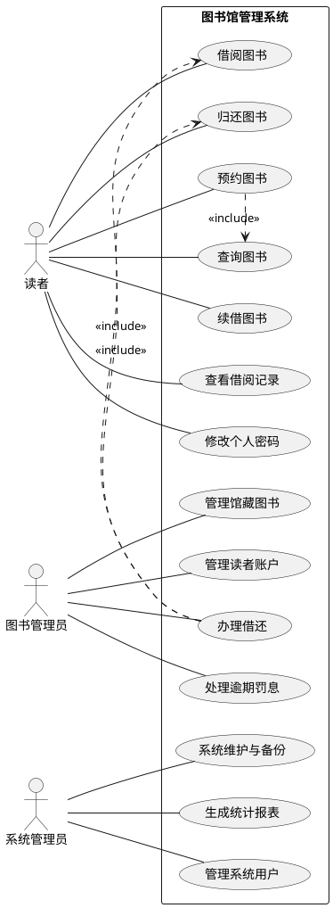

---

## 2. 类图（Class Diagram）

描述系统的核心领域模型：`User` 为抽象基类，派生出 `Reader`、`Librarian`、`SystemAdmin`；`Book` 与 `BookItem`（副本）为一对多关系；`BorrowRecord`、`Reservation`、`Fine` 记录业务实体。

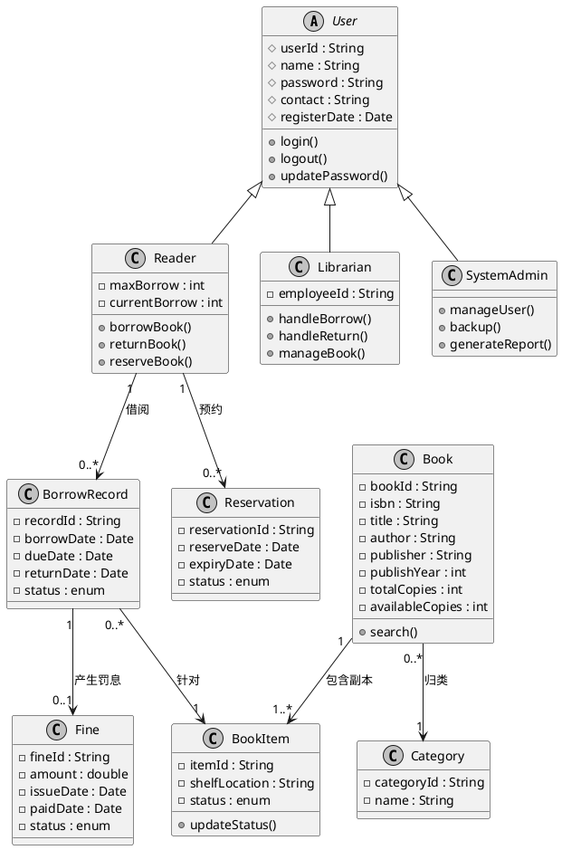

---

## 3. 对象图（Object Diagram）

描述某一时刻（2026-11-06）系统中的一个具体快照：读者"戴欣阳"借出了一本《软件工程》的某个副本。

```plantuml
@startuml
skinparam monochrome true

object Reader as r1 {
  userId = "R2026001"
  name = "戴欣阳"
  maxBorrow = 5
  currentBorrow = 1
}

object Book as b1 {
  bookId = "B1001"
  isbn = "9787111111111"
  title = "软件工程"
  availableCopies = 2
}

object BookItem as i1 {
  itemId = "I1001-01"
  shelfLocation = "A-3-2"
  status = BORROWED
}

object BorrowRecord as rec1 {
  recordId = "L20261106-001"
  borrowDate = 2026-11-06
  dueDate = 2026-11-20
  status = BORROWED
}

r1 --> rec1 : 拥有
rec1 --> i1 : 针对
b1 --> i1 : 包含副本
@enduml
```

---

## 4. 顺序图（Sequence Diagram）

描述"读者借阅图书"这一典型交互的事件顺序：从登录、查询、检查副本状态到创建借阅记录、更新状态。

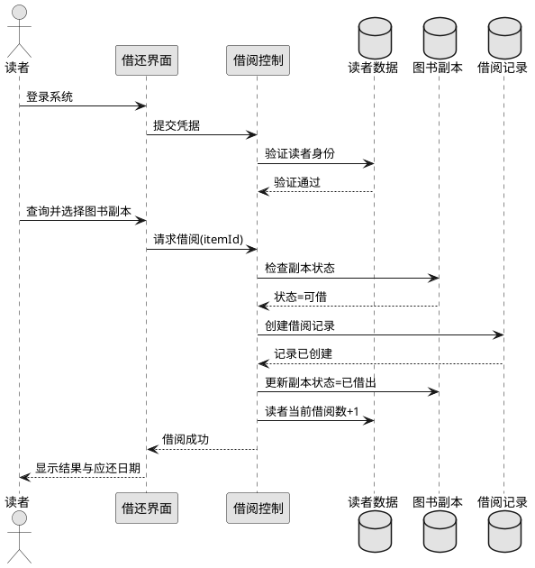

---

## 5. 活动图（Activity Diagram）

描述"借阅流程"的控制流与分支判断（副本是否可借）。

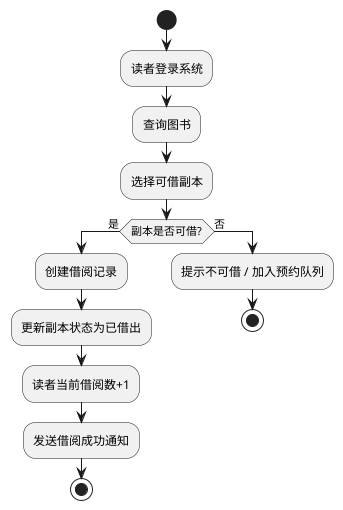

---

## 6. 状态图（State Diagram）

描述 `BookItem`（图书副本）的生命周期状态迁移：在馆可借 → 已借出 → 已归还，以及预约、逾期、维修、遗失等异常状态。

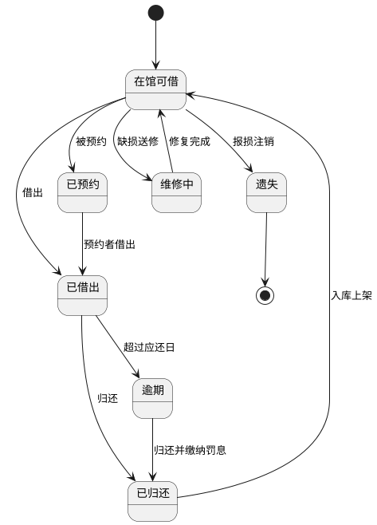

---

## 7. 组件图（Component Diagram）

描述系统的分层组件结构：表现层（Web / 小程序）、业务逻辑层（用户/图书/借阅/罚息管理）、数据访问层与数据库之间的依赖。

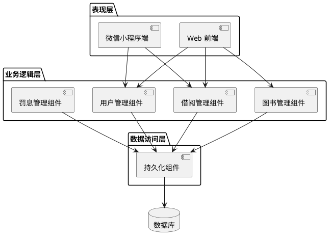

---

## 8. 部署图（Deployment Diagram）

描述系统运行时各硬件节点及其上部署的软件构件，以及节点间的通信协议。

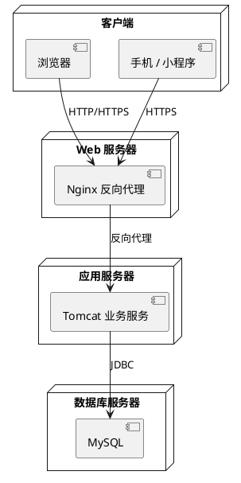

---

## 9. 时序图（Timing Diagram）

描述 `BookItem` 与 `BorrowRecord` 在一段时间内的状态随时间变化（单位：天），体现副本从可借、借出、逾期、归还、维修再到上架的过程。

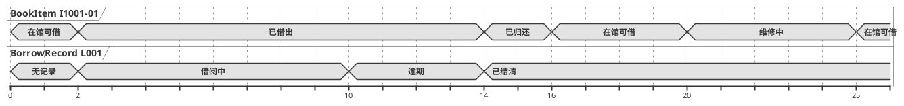

---

## 10. Legacy 语法顺序图（Legacy Syntax）

以下使用 PlantUML 经典（Legacy）顺序图语法（`->` / `-->` 箭头风格，无额外样式声明）描述"管理员办理还书"流程，与第 4 节现代语法形成对照。

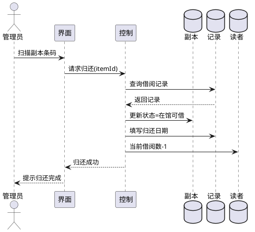

---

## 11. 补充：微信小程序「修改用户名/密码」事件流

### 11.1 事件流活动图

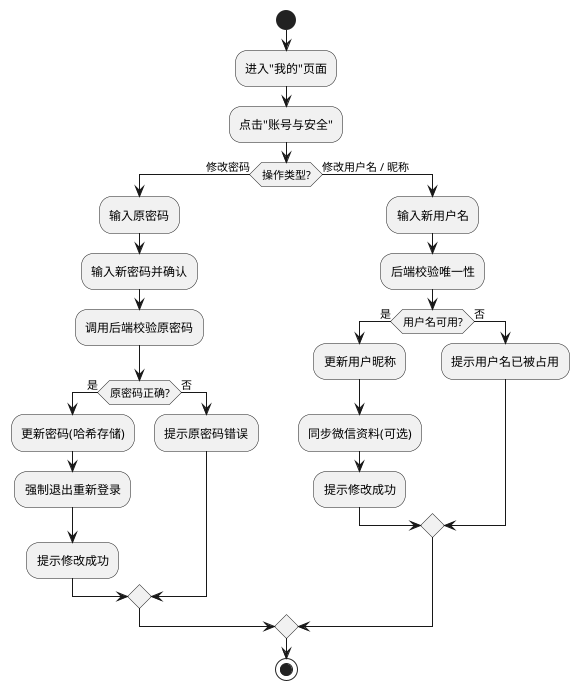

### 11.2 修改操作顺序图（事件流）

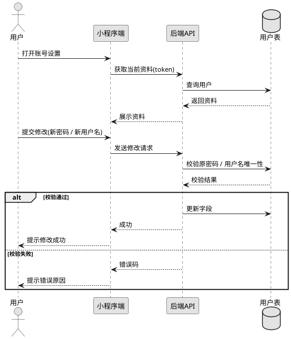
